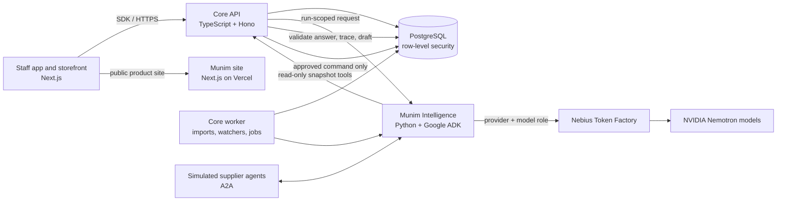

# Munim: the books answer back

Munim is an AI back office for small restaurant groups, cloud kitchens and shops. It connects day-to-day operations—sales,
orders, kitchen tickets, inventory, purchasing, finance, people and compliance—to an auditable system of record. Rules and
watchers surface operational issues; AI specialists explain the evidence, answer questions and draft possible actions. A named
person reviews each consequential change before it is applied.

Munim's defining safety property is simple: **the AI can read approved business snapshots and propose work, but it cannot write
to the books.** A number in an answer is a reference to a cell in a snapshot produced by the database. The app resolves that
reference back to the underlying rows, and refuses unsupported figures with “Cannot verify.” A proposed change is a draft; only
the signed-in person can approve or reject it.

The AI provider is **Nebius Token Factory**, using NVIDIA Nemotron models through its OpenAI-compatible inference API. The
project owner confirmed that the application was live-tested through Token Factory with the Nemotron models listed below.
Model choice is role-based: a fast model routes a request, a reasoning model handles tool-using work, and a vision-language
model extracts structured information from supplier messages and invoice images. Performance observations made against
NVIDIA's separate endpoint remain attributed to that endpoint; they are not presented as Token Factory benchmarks.

The runtime trace records the provider, model and serving path for each call, including recorded fallback.

The demo businesses are **Cobnut Bakehouse**, a two-outlet bakery in Lucknow, and **Kosambari Kitchens**, a three-kitchen South
Indian cloud kitchen in Bengaluru. Both are synthetic, their suppliers are simulated programs, and no money moves
([what is simulated](#what-is-simulated)).

**Public product site:** <https://munim-rho.vercel.app/>. **Interactive demo:** <https://munim-cobnut.vercel.app/staff/sign-in>.
**Rendered project README:** <https://munim-rho.vercel.app/readme>. **Nebius and Nemotron overview:** <https://munim-rho.vercel.app/nebius>.
**Nebius/Nemotron deployment:** <https://munim-nebius-nvidia.vercel.app/>. **Project video:** <https://www.youtube.com/watch?v=eGAfiegcdVw>.
Choose the synthetic owner, Nandini Mehrotra, to explore the staff experience. The public demo uses synthetic business data;
suppliers are simulated and payments are recorded rather than processed. For a reproducible local run with live Token Factory
inference, follow [Run it locally](#run-it-locally) and [Switching to Token Factory](#switching-to-token-factory). The application
has been live-tested through Token Factory. Provider selection is configured per deployment through its environment and
model-role rows; traces record the provider and requested model. The linked demo is the existing hosted product experience,
while [`docs/nebius/DEPLOY.md`](./docs/nebius/DEPLOY.md) describes the isolated Vercel/Supabase profile for a dedicated
Token Factory-backed hosted deployment.

## What the project does

Munim combines a small-business operations suite with evidence-grounded AI assistance:

- **Front of house:** point of sale, QR/web ordering, pickup windows, order status, customer and loyalty workflows.
- **Kitchen operations:** kitchen display, timed tickets, attendance, waste and operating routines.
- **Inventory and purchasing:** stock counts, batches, reorder signals, supplier quotes, purchase-order drafts and receiving.
- **Finance:** ledgers, reconciliation, settlements, month-end close and cited explanations of sales or payout questions.
- **People and compliance:** rosters, attendance, payroll drafts, licences, temperature logs and checklists.
- **Storefronts and country packs:** business-specific ordering sites and India/Australia settings for currency, taxes, time zones
  and supported workflows.
- **Munim Cares:** surplus and near-expiry stock can become an owner-approved donation listing; demo recipients are simulated.
- **AI assistance:** Ask Munim, specialist desks, investigations, watcher findings, invoice extraction and supplier negotiation.

The public showcase contains two synthetic businesses: **Cobnut Bakehouse**, a two-outlet bakery in Lucknow, and
**Kosambari Kitchens**, a three-kitchen cloud kitchen in Bengaluru. The downloadable code and seed tooling can reproduce their
demo data locally. It does not connect to real suppliers, process payments, send customer messages or represent measured
commercial savings.

## Architecture at a glance

The implementation deep dives are in [`docs/architecture/`](./docs/architecture/README.md): AI routing and model roles,
PostgreSQL and event flow, security/approvals, and the Vercel/Supabase deployment profile.



The diagram separates **where inference runs** from **who owns business state**. Token Factory serves the configured Nemotron
roles. Core remains the authority for identity, tenant scope, snapshots, commands, database writes and approval. The AI service
cannot bypass core to update business tables.

### Main components

| Component | Implementation | Responsibility |
|---|---|---|
| Staff app and storefront | Next.js / TypeScript (`apps/web`) | Staff and owner screens, customer storefront, source chips, model attribution and approval UI. |
| Core API | Hono / TypeScript (`services/core-api`) | Public and internal APIs, authentication, snapshot issuance, command validation, drafts, approvals and the only application write path to PostgreSQL. |
| Core worker | TypeScript (`services/core-worker`) | Scheduled watcher sweeps, daily briefs, import parsing, outbox delivery and bounded background investigations. |
| Munim Intelligence | Python 3.12, FastAPI and Google ADK (`services/intel`) | Manager, eight specialists, tool orchestration, extraction, negotiation, grounded answers, spend and trace reporting. It has no database client. |
| Supplier simulator | Python A2A agents (`services/suppliers-sim`) | Synthetic supplier quote and response flows. No real supplier is contacted. |
| Database and migrations | PostgreSQL 18, SQL (`db/`) | System of record, tenant/outlet isolation, append-only ledger and audit, evidence, AI run state and model-role configuration. |
| Hosted platform | Vercel and Supabase | Vercel hosts the Next.js sites and application API; Supabase provides hosted PostgreSQL and the configured identity/storage adapters. The Nebius profile isolates its Vercel pair and Supabase project from the existing public demo. |
| Contracts and SDK | TypeScript/Zod, generated OpenAPI and Python contracts (`packages/`) | Shared request/response shapes used across browser, core and AI service. |
| Demo world generator | TypeScript (`tools/worldgen`) | Deterministic synthetic businesses seeded through the public API. |

## Database design

PostgreSQL is Munim's system of record. The workspace contains 37 forward-only migrations (`db/migrations/0001` through
`0037`). They create separate schemas for business records, evidence, AI state, platform configuration, read-only AI views,
and migration metadata. In hosted deployments, the database can be Supabase-hosted Postgres; Supabase is the hosting/identity
adapter, while the SQL schema and core API define Munim's data and authorization rules.

- **Tenant and outlet isolation:** tenant context is established from a verified identity or signed run token. Row-level
  security scopes queries and writes; the request body cannot choose a tenant.
- **Book guard:** business-book tables have database-enforced write rules. Core's command transaction performs the authorized
  change, audit entry and outbox write together. Reversals record corrections rather than erasing ledger history.
- **Separate runtime roles:** migrations, core routes, internal services and the AI read-only views use distinct database
  roles. The AI read role is limited to the curated `intel_ro` views and is tested for lack of write access.
- **Evidence lineage:** snapshot templates produce typed rows and cells; AI claim references point to those cells. Core
  resolves the references for the viewer and rejects or withholds unsupported claims.
- **Auditable AI configuration:** `platform.model_role` stores provider, provider-specific model ID and price per role. Model
  spend and run traces record which provider/model was requested and whether a call was live, served from a recorded fallback,
  or abstained.
- **Migration discipline:** applied migration files are checksummed and never edited in place; changes arrive in a new
  numbered migration. A local embedded Postgres 18 harness applies the schema for database tests.

The `pgvector` extension is optional for an embedding migration; the current live model-role table does not switch on a live
embedding role. PostgreSQL is also the default graph-edge store. The optional FalkorDB adapter is not required for the Nebius
submission or core demo.

## How the AI back office works

1. A person asks a question or opens a finding in the staff app.
2. Core authenticates the person and tenant, then issues a signed, time-bounded run token containing the allowed business
   scope. The model does not select the tenant or receive database credentials.
3. The Manager's router selects a workflow and specialist. Read tools expose only curated, parameterized snapshots through
   core's internal API.
4. A reasoning specialist may call bounded read tools and return a response with claim references. Extraction and vision
   tasks instead receive untrusted source text/image content and return schema-constrained fields without tools.
5. Munim validates the response: numbers must resolve to snapshot cells; extracted claims must match the source spans; proposed
   actions must fit the deterministic policy checks. Unsupported answers abstain.
6. Core displays the answer and evidence or stores a draft. A human explicitly approves/rejects it; the AI cannot apply it.
7. Provider/model IDs, serving mode, tool activity and spend metadata are recorded for audit and product tracing. Sensitive
   prompt/source text is not copied into the trace labels.

### Why these Nemotron roles and models

The roles use different model shapes because their tasks have different constraints: routing should be quick and structured;
multi-step analysis benefits from a stronger reasoning budget; supplier text and invoice photographs need reliable structured
extraction, with image understanding for invoices. Role configuration is centralized in `platform.model_role`, so provider
and model selection can change without changing specialist business logic.

| Role | Nebius Token Factory model ID | Why it is assigned this role | Guardrail |
|---|---|---|---|
| `router` | `nvidia/Nemotron-3_5-Lightning` | Fast constrained intent/route selection before the Manager spends time on a deeper workflow. | A fixed enum/structured result; core decides what tools and specialist are actually available. |
| `reason` | `nvidia/nemotron-3-super-120b-a12b` | Multi-step tool-using analysis, specialist responses and negotiation choices within deterministic bounds. | Read-only tools, bounded run budgets and cite-or-abstain response validation. |
| `extract` | `nvidia/Nemotron-3.5-Super-VL` | Converts supplier quote text and related untrusted content into typed fields. | No tools; schema validation and field-to-source checks. |
| `vision` | `nvidia/Nemotron-3.5-Super-VL` | Reads invoice images and extracts printed line items and figures. | No tools; figures must be supported by source spans and a person reviews the resulting draft. |
| `narrate` | `nvidia/Nemotron-3.5-Super-VL` | Turns already-detected findings and cited cells into short explanations. | The deterministic finding and cited data remain authoritative; invalid narration falls back to a template. |

These are the confirmed Token Factory model-role IDs used by the project. They are provider-specific identifiers; the NVIDIA
endpoint uses different IDs. The owner has confirmed live application testing with these Token Factory model roles. The
historical latency and response-quality measurements elsewhere in this README were collected separately on NVIDIA's endpoint
and must not be treated as Token Factory performance measurements.

**What Token Factory contributes.** One OpenAI-compatible inference endpoint let Munim connect its existing Google ADK model
adapter to hosted Nemotron inference without provisioning or operating GPUs. The same provider integration serves the five
model roles; the model ID and provider are selected through audited platform configuration rather than separate hard-coded
agent implementations. This made it practical to try a fast routing model, a deeper reasoning model and a vision-language model
inside one application workflow. These are integration and deployment benefits, not a claim of measured Token Factory latency
or cost improvement. The hosted deployment still needs its own Token Factory credential and model-role configuration.

## Open demo paths

- [Munim product site](https://munim-rho.vercel.app/) — product overview, developer portal and public entry point.
- [Open Cobnut storefront](https://munim-cobnut.vercel.app/) — browse the synthetic bakery's storefront and order flow.
- [Open Nebius/Nemotron deployment](https://munim-nebius-nvidia.vercel.app/) — dedicated deployment supplied for the hackathon.
- [Open staff demo](https://munim-cobnut.vercel.app/staff/sign-in) — select **Nandini Mehrotra (Owner)**. Explore Ask Munim,
  evidence/source chips, inbox findings, stock and supplier/purchase workflows. Other demo personas are available at sign-in.

The Cobnut links point to the existing public product/demo deployment. The dedicated Nebius/Nemotron deployment is listed
separately because provider selection is deployment-specific. The project owner reports that the application was tested with
live Nebius Token Factory inference; no latency, quality or cost benchmark is claimed here.

## Two minutes to the point

Once it is running (set-up below, about ten minutes on a laptop), sign in at <http://127.0.0.1:3000/staff/sign-in> with the demo
picker and choose the owner.

1. **The inbox finds the leaks; rules find them, not a model.** Seed Kosambari Kitchens (`make demo WORLD=blr_kitchen`). Its books hold
   four planted problems, and Munim's watchers raise each one on their next quarter-hour run: Swiggy taking 30% where the
   contract says 22% on 18 Indiranagar orders (₹483.84), a Zomato ad fee at HSR Layout that nobody opted into (₹550), urad dal
   creeping from ₹125 to ₹145 a kilo (₹3,000), and a Whitefield cook clocking out an hour late on 18 of 26 shifts (₹3,240).
   Each amount carries a source chip; tap it to open the snapshot rows it came from. Start that seed just after a quarter-hour:
   a watcher run that lands mid-seed also raises stale dead-stock findings ([limitations](#limitations)).
2. **Ask Munim, live on Nemotron** (needs a key, see [switching to Token Factory](#switching-to-token-factory)). On Cobnut, ask
   "Which ingredients are below their reorder level?". The answer names the agent that wrote it, and each quantity in it is a
   chip that opens the stock rows. Ask something the books cannot support and the answer says "Cannot verify" instead of
   guessing.
3. **A negotiation that ends in a draft, not an order** (live models). On the owner's home, "Request quotes" on an
   ingredient that is running low: the reasoning model negotiates with three simulated suppliers inside rules that fix every price it may offer,
   the vision-language model reads each reply, a deterministic deal check runs, and a purchase-order draft lands in the inbox
   for a person to approve or reject. The draft's saving against the last price paid is a cell of the quote comparison, not a
   figure a model wrote, and its chip opens the rows.
4. **An invoice photo that becomes a draft** (live models). On the suppliers screen, upload a photo of a supplier invoice. The
   synthetic one used here is from "Lalbagh Nut & Spice (simulated)", for roasted hazelnuts, the same item as the negotiation.
   The vision-language model reads it with no tools. Each figure in the draft is a span of the page ("Read on the page"), and
   the person types the figures they approve; a figure that is not on the page withholds the whole draft.

## Run it locally

Everything runs on your machine: an embedded Postgres 18 and every service as a local process. No Docker and no cloud
account. Without a key, the AI service answers from recorded model responses (below); everything else, the watchers included,
works the same.

**Prerequisites:** macOS or Linux; Node 22.18 or later (it runs TypeScript directly); pnpm 11 (`corepack enable` picks the
version in `package.json`); [uv](https://docs.astral.sh/uv/) for the two Python services (it fetches Python 3.12 if you do not
have it); `curl` and `make`.

```bash
pnpm install --frozen-lockfile
make up                       # embedded Postgres, the AI service, the simulated suppliers, core-api, core-worker
make demo                     # seeds Cobnut Bakehouse through the public API (about three minutes), then starts the web app
make demo WORLD=blr_kitchen   # seeds Kosambari Kitchens (about six minutes) and restarts the web app as it
```

Then open <http://127.0.0.1:3000/staff/sign-in> and pick the owner (Nandini Mehrotra at Cobnut, Shalini Rao at Kosambari). The
storefront is at <http://127.0.0.1:3000/>. `make web WORLD=cobnut` switches the web app back without seeding again,
`make demo-tokens` mints fresh sign-in tokens (they last an hour), and `make down` stops everything and throws the local
database away. What each target does is in the [`Makefile`](./Makefile).

Seed Cobnut first: its seed prices the AI roles (at zero, in rupees) for the whole local platform, and a business whose roles
have no price runs its rules but no live model.

### Switching to Token Factory

With the stack up and Cobnut seeded:

```bash
echo 'NEBIUS_API_KEY=<your Token Factory key>' >> .env     # read only by the AI service, through munim_intel/config.py
MUNIM_MODEL_MODE=live MUNIM_ASK_BUDGET_S=80 scripts/dev/restart-svc.sh intel   # the AI service, live; the seeded data stays
node scripts/dev/nemotron-roles.ts --provider=nebius \
  --prices-file=.run/local/model-prices.json
node scripts/dev/nemotron-smoke.ts --provider=nebius
```

- `nemotron-roles.ts` points every model role at its Token Factory id through an operator configuration draft that the local
  operator proposes and approves (no SQL), then reads the roles back. The JSON file supplies positive per-role input/output prices
  from the current provider rate card in minor currency units per million tokens; the business's monthly AI cap uses these prices.
  Use keys `router`, `reason`, `narrate`, `extract`, `vision`, each with `input_price_per_mtok_minor`,
  `output_price_per_mtok_minor` and `price_currency`. All roles must use the same currency because role pricing is platform-wide.
  `--zero-prices`
  is available only for a local smoke run and causes the cap to ignore provider spend, so it is not the submission configuration.
- `nemotron-smoke.ts` asks one question and runs one investigation step on the seeded Cobnut, then reads back the runs' spend
  rows and traces. It fails unless every model call was served live by `nebius` with a Nemotron id, the answer cites resolved
  cells, and the narration came from the model rather than the template.
- `MUNIM_ASK_BUDGET_S=80` gives the reasoning model room inside core's 90-second wait for an answer. A plain restart of the AI
  service, or `make up` without `MUNIM_MODEL_MODE=live`, comes back on recorded responses.
- `--provider=nvidia` with `NVIDIA_API_KEY` runs the same path on NVIDIA's own endpoint.

The API's provider list and the database both accept `nebius` as a model role's provider. The project owner has verified live
Token Factory inference from the application. The smoke command above is the repeatable verification path for a configured
environment; it fails if the requested provider is not the provider that served a call.

For the separate hosted deployment, use [`docs/nebius/DEPLOY.md`](./docs/nebius/DEPLOY.md). Its environment setup configures the
Nebius API key and live inference mode, while model selection remains in the database. After deploying the new Vercel/Supabase
pair, [`scripts/dev/nemotron-roles-hosted.ts`](./scripts/dev/nemotron-roles-hosted.ts) sets and reads back the five Nemotron roles
through audited operator configuration drafts. It requires an operator token and per-role nonzero Token Factory prices so the
application's spend accounting is not silently bypassed.

## Where Nemotron and Token Factory are used

Each model role is one row in `platform.model_role`: a provider, a model id and a price. The AI service (`services/intel`,
Python on Google ADK) builds every model from that row, so switching providers is a configuration change, never a code change.
Paths in the last column are under `services/intel/munim_intel/`.

| Role | What the agent does with it | NVIDIA endpoint id (run live) | Token Factory id | Call sites |
|---|---|---|---|---|
| `router` | Chooses how to handle a question (look it up, explain, investigate, draft a request, …) as one constrained choice | `nvidia/nemotron-3.5-lightning-30b-a3b` | `nvidia/Nemotron-3_5-Lightning` | `decide/mimic.py` (`router_decision_model`), called by `route` in `manager/ask.py` |
| `reason` | The Manager and the eight specialists: call snapshot tools, read the cells, write the answer citing them. In a negotiation, picks among the moves the rules allow | `nvidia/nemotron-3-ultra-550b-a55b` | `nvidia/nemotron-3-super-120b-a12b` | `default_models` in `manager/ask.py`; `negotiate/route.py` |
| `extract` | Reads a simulated supplier's reply into a typed quote, with no tools; each field must be found in the reply's text | `nvidia/nemotron-3.5-super-vl-120b-a12b` | `nvidia/Nemotron-3.5-Super-VL` | `negotiate/route.py`, `ingest/quarantine.py` |
| `vision` | Reads a supplier invoice image into a typed invoice, with no tools; every figure must be a span of the page | `nvidia/nemotron-3.5-super-vl-120b-a12b` | `nvidia/Nemotron-3.5-Super-VL` | `ingest/invoice.py` (through `ingest/quarantine.py`) |
| `narrate` | Words a watcher's finding or an investigation step from its cited cells; a line that breaks core's grammar keeps the template | `nvidia/nemotron-3.5-super-vl-120b-a12b` | `nvidia/Nemotron-3.5-Super-VL` | `watch_narrator` and `narrate_model` in `app.py`; `narrate/__init__.py`; `watch/pipeline.py` |

The ids per provider are in [`scripts/dev/nemotron-roles.ts`](./scripts/dev/nemotron-roles.ts). The `embed` role is not
switched: the AI service builds no live embedding model.

These are the model IDs configured for the Token Factory roles and confirmed by the project owner as the models used by the
application's Token Factory AI layer. A live trace and spend row identify the provider and requested model for each run; the
project owner has verified live inference through Token Factory from the application. No per-role latency or benchmark result
is inferred from that verification.

The marketing site's Nebius page accepts `NEXT_PUBLIC_MUNIM_DEMO_ORIGIN` at build time. It defaults to the existing Cobnut demo.
Set it to `https://munim-nebius-nvidia.vercel.app` when rebuilding `apps/site` to point those page links to the dedicated
Nebius/Nemotron deployment.

**The provider.** `nebius` is one entry in the provider registry,
[`services/intel/munim_intel/llm/providers.py`](./services/intel/munim_intel/llm/providers.py): Token Factory's
OpenAI-compatible endpoint, `https://api.tokenfactory.nebius.com/v1/`, with its own key, `NEBIUS_API_KEY`, which the config
module redacts like every other key. The database accepts it as a provider of a role and of a spend row
([`db/migrations/0036_ev3_nebius_provider.sql`](./db/migrations/0036_ev3_nebius_provider.sql)).

**What running on Nemotron took** (measured on NVIDIA's endpoint, 24 Oct 2026; the same code path serves Token Factory):

- **Thinking off for structured calls.** Nemotron reasons before it answers unless the request says
  `chat_template_kwargs: {"enable_thinking": false}`. With reasoning on, the router's one-word choice took 19 seconds (its
  timeout is 20) and a claims read ran past its 30-second limit; with it off, each took about a second. Every role except
  `reason` is sent with thinking off; `reason` keeps it, with a larger output ceiling, since reasoning tokens count against it.
- **Strict JSON schema.** Nemotron honoured OpenAI-style strict `response_format: json_schema` for the quote, the claims, the
  invoice and the router's choice, so no looser output mode was needed. A reply that still misses its schema gets one retry,
  told only where and what kind the problems were, never the text it sent (that text may come from a supplier).
- **Reasoning text never reaches a reader.** The reasoning arrives in `reasoning_content`, which nothing reads; a provider that
  inlines it as `<think>…</think>` has it cut from every text part before anything parses or shows it.
- **Every call is labelled.** Each model call's trace carries its provider, model id and how it was served (`live`,
  `recorded-fallback` or `abstained`), and its spend row names the same provider and model. The staff app shows the model
  beside the agent on findings and drafts whose trace names one.

**Live evidence so far** (NVIDIA's endpoint, a locally seeded Cobnut, 24 Oct 2026):

- Ask, "Which ingredients are below their reorder level?": the router on 3.5 Lightning, three reasoning calls on 3 Ultra, an
  answer citing four cells of one stock snapshot, all four resolved; about 20 seconds end to end.
- An investigation step narrated by 3.5 Super VL in about 1.3 seconds, the model's lines used rather than the template.
- A request for quotes on roasted hazelnuts: ten model calls, all served live (seven reads of supplier replies on 3.5 Super VL,
  three choices on 3 Ultra). One simulated supplier came down from ₹1,509.60 to ₹1,465.20 a kilo over three rounds, and the
  purchase-order draft's quantity and price are both cells of the negotiation's quote snapshot.

**A gate on the host.** `services/intel/tests/test_nebius_host.py` builds every role as a run builds it, calls each through its
own call site with the HTTP layer intercepted, and fails unless at least five requests went out and every one went to
`api.tokenfactory.nebius.com`. A paired test plants one role on NVIDIA's endpoint and must be caught. It runs in the
recorded test suite and needs no key: 3 tests pass.

## Limitations

These are the places where Munim stops short today, measured rather than guessed. Every timing and answer rate here was taken
live on Nemotron through NVIDIA's own endpoint (24 and 27 Oct 2026), on synthetic businesses.

The application was live-tested through Nebius Token Factory. The answer-rate and latency figures below are historical
measurements from NVIDIA's separate endpoint and are labelled with that source; they are not Token Factory benchmarks.

- **Ask abstains when the books cannot back the answer.** On 27 Oct, one run each: "Which ingredients are below their reorder
  level?" (48 s), "How did net sales go this week?" (35 s), "What was labour as a share of sales last week?" (58 s) and "How
  much stock is at risk of expiring in the next three days?" (27 s) answered on Cobnut, every figure a resolved reference.
  Kosambari's "Why was my Swiggy payout at Indiranagar short?" abstained on both runs (80 s and 72 s, no resolved reference).
  On 24 Oct the expiry question had answered on four runs of six (the misses were a sentence that cited no cell and a typed
  number, both refused) and the payout question on two of four (the others ran past the 80-second budget). Every miss ends as
  "Cannot verify", never as an error and never as an uncited number.
- **Latency.** An Ask that calls tools takes 27 to 58 s on the reasoning model, and the payout question needs four to six
  reasoning steps against an 80-second budget. These are NVIDIA-endpoint timings; they should not be read as Token Factory
timings.
- **Names in a sentence are checked less strictly than numbers.** Every figure is a cell, and a sentence that names an outlet
  must cite one of that outlet's cells. But no read carries a delivery channel's name, so "Swiggy" in a payout answer comes
  from the question, not the books (its figures are cited, from reads scoped to that outlet). And a read with no rows has no
  cell to cite: the model is told to leave it out, but a clause such as "no orders are missing from payouts" folded into a
  cited sentence is not caught by any check yet.
- **The invoice chain reads photos, not yet PDFs.** A photo read by the vision-language model becomes a draft of page spans, and
  the same hazelnuts reach a purchase-order draft with a cited saving. A PDF upload is accepted, but the one live try ended in a
  model error and the draft abstained. The saving compares against the last costed receipt on or before the quote's date, so a
  later-dated invoice can make it negative.
- **The web price check is not in this build.** A market price from a web search (Tavily) is meant to enter only as an
  owner-approved import and show only as a cell, labelled recorded until a key is set.

  Tavily is an optional integration and separate bonus-track item; it is not required for the Nebius model-provider integration.
- **One price currency for the model roles.** Roles are priced platform-wide in rupees. A business that budgets in another
  currency (Australian dollars, on the Australian country pack) gets no live model: its rules and watchers still run, and its
  AI surfaces show their templates.
- **Recorded responses are not live ones.** Every test and a fresh local run without a key use recorded model responses, which
  answer only the exact requests they were recorded from, so on a freshly seeded business Ask abstains until a key is set. In
  live mode a call that fails is served from its recording when one exists, and its trace says `recorded-fallback`.
- **A rebuilt database keeps the roles the seed gave it.** After a fresh seed the model roles point at the seed's default
  provider, not at Nemotron; `node scripts/dev/nemotron-roles.ts` repoints them. Without it the smoke fails by naming the provider
  that served the Ask.
- **Provider model availability can differ.** `nemotron-3-super-120b-a12b` and `nemotron-nano-3-30b-a3b` answered 404 on the
  NVIDIA account used, so that endpoint's `reason` role ran on 3 Ultra. The application records the configured and served model
  per call; model IDs are provider-specific.
- **Routing has no confidence score on Nemotron.** The framework's OpenAI-compatible client does not request log-probabilities,
  so the router's choice is taken as given; it once chose "investigate" for a plain lookup.
- **Reasoning tokens are counted twice as output.** It costs nothing at a zero price and overstates spend once Token Factory
  is priced.
- **A watcher run during a seed leaves stale findings.** The watchers run every quarter-hour. One that fires while Kosambari is
  still importing its history (opening stock in, consumption not yet) raises dead-stock findings that do not close on their
  own; dismiss them, or start the seed just after a quarter-hour.
- **Synthetic data only.** No real business, customer, supplier or payment is involved; the "₹ found" figures above are
  measured on synthetic books.

## The One Guarantee

> Nothing changes the books without a named person's approval, and every number shown traces to a ledger row.

- **The AI service cannot write.** It has no database client; the database roles it can reach have no write grant on any book
  table, and it posts traces, spend rows, answers and drafts to core's internal API, which validates each.
- **Numbers come from snapshots.** A model never types a number a person reads: it cites a cell (`⟨snap:ID·row·col⟩`) of a
  snapshot core minted with SQL, core resolves it for the viewer, and anything that does not resolve is shown as "Cannot
  verify".
- **Acting is a draft.** A specialist proposes; a named person approves, edits or rejects; the approved change runs in one
  transaction with its audit entry, under the approver's identity. Nothing auto-applies.
- **Untrusted text stays quarantined.** Supplier replies and invoices are read by a model with no tools, into a schema, and every
  field is checked against the source text; traces carry ids and short labels, never that text.

More implementation detail is in [`services/intel/README.md`](./services/intel/README.md),
[`services/core-api/README.md`](./services/core-api/README.md), [`services/core-worker/README.md`](./services/core-worker/README.md),
[`db/README.md`](./db/README.md), the SQL in [`db/migrations/`](./db/migrations/),
[`services/intel/munim_intel/llm/providers.py`](./services/intel/munim_intel/llm/providers.py), and the role map in
[`scripts/dev/nemotron-roles.ts`](./scripts/dev/nemotron-roles.ts).

## What is simulated

- **All data is synthetic.** Cobnut Bakehouse and Kosambari Kitchens, their people, customers and six months of history are
  generated by `tools/worldgen`.
- **Suppliers are simulated.** Every supplier is a program in `services/suppliers-sim`, and every screen that names one says
  "Simulated supplier". No real business is contacted.
- **Payments are recorded, never processed.** No money moves.
- **Nothing is sent** to a real customer, supplier or regulator.

## Tests

The tests run on an embedded Postgres with recorded model responses; none needs a key or a network service.

```bash
export CI=true MUNIM_MODEL_MODE=recorded
pnpm -r run typecheck
node_modules/.bin/depcruise --config .dependency-cruiser.cjs --output-type err apps services packages adapters tools
uv run --locked --directory services/intel --with pytest==9.1.1 pytest -q    # the AI service
(cd apps/web && node_modules/.bin/vitest run)                                # the web app
apps/web/scripts/bundle-isolation.sh   # a production build per business, each carrying only its own business
```

Every other package has its own suite (`node_modules/.bin/vitest run` in `db`, `services/core-api`, `packages/*`;
`node --test "test/*.test.ts"` in `tools/worldgen`).

The graph adapter's tests (`adapters/falkordb`) start a FalkorDB server that `node scripts/dev/fetch-falkordb.ts` downloads
first; Postgres is the graph backend by default, and `MUNIM_GRAPH=falkordb` selects FalkorDB.

## What is here

| Path | What |
|---|---|
| `services/intel` | The AI layer (Python, Google ADK): the Manager, eight specialists, watchers, investigations, negotiation, the providers |
| `services/core-api` | The system of record and the only writer of Postgres: commands, drafts and approvals, snapshots, the public `/v1` API |
| `services/core-worker` | The long-running worker: the outbox, the watchers' schedule, imports, investigations |
| `services/suppliers-sim` | Three simulated supplier agents over A2A |
| `apps/web` | The storefront and the staff screens; one build per business (`NEXT_PUBLIC_MUNIM_SITE`) |
| `packages/` | Contracts (zod, with the generated OpenAPI and Python models), domain logic, config, the TypeScript SDK |
| `db/` | Forward-only SQL migrations with row-level security, the migration runner, the embedded-Postgres test harness |
| `tools/worldgen` | The two synthetic businesses, seeded through the public API, and the recompute of Kosambari's planted problems |
| `adapters/` | Sign-in and file storage (local, a hosted Postgres's, Google Cloud's) and the optional FalkorDB graph backend |
| `deploy/vercel` | A hosted deployment's build and environment set-up |
| `scripts/dev` | The local set-up and the Nemotron role switch and smoke |

## Documentation

| Page | What it covers |
|---|---|
| [`docs/overview.md`](./docs/overview.md) | What Munim is, its two parts and the One Guarantee |
| [`docs/ai-agents.md`](./docs/ai-agents.md) | The Manager and the specialists, run tokens, tools and handles, cite-or-abstain, negotiation, traces, models |
| [`docs/core-architecture.md`](./docs/core-architecture.md) | Tenancy and row-level security, the book guard, commands, events and drafts, live updates, country packs |
| [`docs/security.md`](./docs/security.md) | Threat model, who can act, and where each control lives |
| [`docs/glossary.md`](./docs/glossary.md) | Terms |

## Licence

Munim is licensed under the [Apache License 2.0](./LICENSE).
