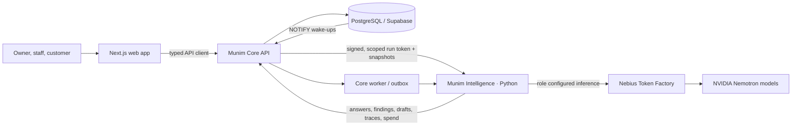

# Munim architecture guide

Munim is a multi-tenant operating system for small restaurant groups, cloud kitchens and shops. Its product surface combines point of sale, kitchen operations, stock and purchasing, finance, people, customer workflows and an AI back office. This guide describes the implementation in this repository and distinguishes runtime behavior from optional infrastructure and demo fixtures.

## System map

The critical boundary is between **Core**, which owns business state and writes, and **Intelligence**, which interprets and proposes. Inference can help explain records or prepare a draft, but it has no direct database connection and cannot commit a business change.

## Runtime components

| Component | Implementation | Responsibility |
|---|---|---|
| Marketing site | Next.js App Router, React, TypeScript (`apps/site`) | Public product, developer, Nebius and rendered README pages. The site package is intentionally small: Next.js, React and React DOM at runtime. |
| Product web app | Next.js App Router, React, TypeScript (`apps/web`) | Customer storefront and staff experience: POS, kitchen, owner home, Ask, approvals and operational modules. |
| Core API | Hono, TypeScript | Identity and tenant scope, commands, read snapshots, drafts, approvals, audit, outbox, internal Intelligence API and server-sent event streams. |
| Core worker | TypeScript process | Retries committed outbox events and runs scheduled watch sweeps and other background work. |
| Intelligence | Python service using the Google ADK runtime and an OpenAI-compatible provider adapter | Route questions, load specialist skills, read approved snapshots, narrate findings, extract fields from untrusted input and prepare draft proposals. |
| Data store | PostgreSQL; Supabase provides hosted Postgres/Auth/Storage ports in the standalone profile | System of record, row-level tenant isolation, evidence, model-role configuration, audits, traces, spend and graph edge tables. |
| Supplier simulator | Python A2A service | Provides clearly labelled synthetic supplier agents for quote workflows. |
| Inference | Nebius Token Factory serving configured NVIDIA Nemotron role IDs | Hosted model inference. Provider, model ID and price are role configuration; changing a model does not grant it new data access or write authority. |

The production topology is deployment-specific. The proposed hackathon profile places the Next.js site/API on Vercel and data services on a dedicated Supabase project. Intelligence remains a Python service and needs a Python-capable host; it is not made deployable by the Next.js Vercel build alone. See [deployment profile](deployment.md).

## Main request path

1. A browser request reaches Core through the typed SDK. Core verifies identity and resolves tenant, role and outlet scope from its trusted records.
2. For an AI operation, Core creates a short-lived Ed25519-signed run token containing the tenant, outlet scope, actor, run and trigger. Intelligence receives no caller-supplied tenant selector.
3. The Manager classifies the request and loads only the supported skill/tool set for that path. Tools call Core to mint curated SQL snapshots; model context contains bounded digests and opaque evidence handles rather than unrestricted database access.
4. The configured role calls the model provider. The service records provider, model ID, route, outcome and spend. A model response is a candidate explanation or typed extraction, not a database command.
5. Validators resolve all evidence references, enforce number/provenance rules, and reject unsupported claims. Unsupported answers become a fixed “Cannot verify” response.
6. Any proposed mutation is stored as a draft with its evidence and base snapshots. A named human reviews it. Core rechecks authority and stale snapshots, applies the approved command and audit record transactionally.
7. Core publishes an outbox event after commit. The worker retries unpublished events; duplicate event IDs are claimed once by Intelligence.

## Product and demo boundaries

The project includes a staff back office, customer storefront, POS, kitchen display, owner home, approval inbox, Ask, investigations, supplier workflows, purchase orders, campaigns, page builder and Munim Cares. The public examples use synthetic business records. Supplier agents and recipient organizations are simulated. Payment state is recorded; Munim does not process payments.

The AI boundary is intentional: it may explain, classify, extract or draft. Core and SQL determine business facts, permissions and state transitions. This design makes a provider/model swap an inference configuration change rather than a trust-boundary change.

## Deep dives

- [AI routing, Nemotron roles and evidence controls](ai-layer.md)
- [PostgreSQL data model, tenancy and event flow](data-and-events.md)
- [Security boundary and approval model](security-and-approvals.md)
- [Vercel, Supabase and Python service deployment profile](deployment.md)
- [Repository README](../../README.md)
