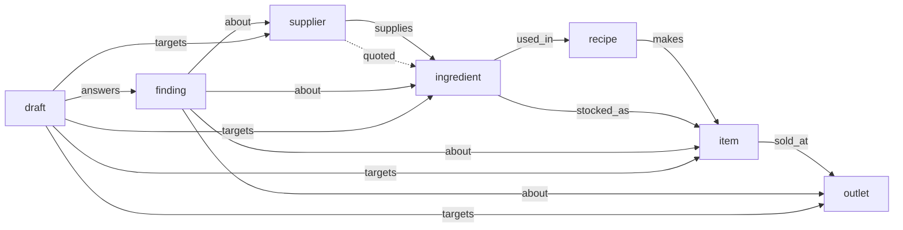

# FalkorDB entry: graph design, queries, features, export, build plan (F1 / T-131, 16 Oct 2026)

**Binds:** ledger R12, R25, R26, R40 C3, R54 P-5, R56 G-3, R62 S-5; CLAUDE.md rules 1–4, 11, 12, gotcha 10;
`docs/admin/falkordb-rules-snapshot-2026-10-15.md` (event rules 2, 3, 4, 8, 10). Design only: no product code was
changed for this document. The spike that ran every query below lives outside the repo (§11).

**Labels.** FACT = read in the code, a migration or a command's output today. INFERENCE = reasoned from those.
UNVERIFIED = not checked. Sections marked **[public]** contain no ledger ids, no internal process and none of the private
known gaps, so F4 can lift them into the FalkorDB repo's README and `GRAPH.md` almost as written. F4 replaces each "Spike:" line
with the name of the test that holds it, and each `§` cross-reference with a link. Every other section is internal.

---

## 0 · The decisions in one table

| # | Decision | Why |
|---|---|---|
| D1 | **Core is the only writer of the graph.** core-api / core-worker project it from core's book tables; intel never holds a FalkorDB credential and never writes the graph. | R25 holds and tightens: intel has no write grant anywhere. This **narrows R25's last bullet** ("intel's projector writes it directly"), which removes one write path. Flagged once in §12 for the ledger. |
| D2 | **One FalkorDB graph per tenant**, key `munim:<tenant_id>`, named by core from the verified run or member token, never from a body, a parameter or a model. | FalkorDB has no RLS. One graph per tenant means a Cypher query cannot reach another tenant: there is no predicate to forget. Dropping or rebuilding a tenant is one key. FACT (spike): the same ids in two graphs never mix. |
| D3 | **Node ids are core row ids** (outlet, supplier, ingredient, recipe version, item, finding, draft). | A snapshot's `item_id` cell and a graph node share the same id. A graph answer joins a margin row with no lookup, and no `intel.entity` CHECK or migration is needed. |
| D4 | **The graph is rebuilt, not patched.** One function, `ensureFresh(tenant)`, computes the whole projection in one SQL statement plus a sha256. If the sha differs from the graph's `projection` node, it builds a fresh staging key and `RENAME`s it over the live key. It runs before every graph read, on the core-worker tick and at the end of a seed. | The outbox carries no catalogue or price events (FACT), Vercel Hobby ticks once a day (R55 S-2), and `valid_to` closes are UPDATEs. A full checksum catches all three; a watermark would not. Small tenants make it cheap (spike: 47 nodes in 27 ms, 1,086 nodes / 5,134 edges in 56 ms). |
| D5 | **Every read is `GRAPH.RO_QUERY`** with static query text, parameters only, `TIMEOUT 1000`. | The engine refuses a write on that command (FACT, spike), so a template can never change the graph. |
| D6 | **No Postgres fallback in the FalkorDB build.** If FalkorDB is unreachable, the graph routes answer 503 `graph_unavailable`, the screen says so and intel's graph tools say "offline". The export leaves out the Postgres graph templates. | Event rule 3: "if the product still works once FalkorDB is taken out, the graph is decoration". |
| D7 | **Intel's graph tools stay byte-identical** (names, descriptions, argument schemas). In the FalkorDB build they run on FalkorDB behind core's existing `POST /internal/intel/v1/graph:query`. | Recorded-fixture keys hash tool declarations and system text. Six committed fixtures expose `graph_price_shock_path` and `graph_supplier_dependency` (FACT: `grep graph_ services/intel/fixtures/recorded`), so any change to those declarations breaks all six. |
| D8 | **The graph holds no numbers to show and no model text.** Properties are ids, names a member entered, codes, booleans and a snapshot cell's address. People, customers and orders are not projected. | One Guarantee clause 2 (R25, R26): every number shown comes from a snapshot cell. FalkorDB has no RLS, so personal data stays in Postgres. |
| D9 | **The adapter lives in `adapters/falkordb/`**: TypeScript, core-side, its own workspace package and the only one depending on npm `falkordb`. It carries its own mapping (`adapters/falkordb/env.ts`: the `falkordb` mode and the `MUNIM_FALKORDB_URL` name), which `packages/config` loads by a computed path exactly as it loads `adapters/dev/env`. **No Cup-exported file names FalkorDB**: core-api and packages/config know only a neutral graph-backend port. The old Python adapter `adapters/dev/graph-falkordb/graph_falkordb.py` (intel-side writer, never run against a server) is deleted, along with the FalkorDB mentions in intel's graph docstrings. | The Cup export lists only `adapters/gcp/`; its pnpm workspace and lockfile filter (`export.py`) drop the adapter's importer, and it builds without the adapter. The FalkorDB export lists `adapters/falkordb/` and builds without the Postgres templates. |

## 1 · What exists today (FACT unless labelled)

- **Graph port, Postgres default.** Five templates are core-owned SQL in `services/core-api/src/internal/graph/*.sql`,
  run by `graph:query` as `munim_svc` with the tenant and outlet scope bound from the run token. Every leg goes through
  `visible.sql`, which serves outlet-scoped runs. Intel keeps only the template names and their arguments
  (`munim_intel/graph/port.py`, `postgres.py`, `tools.py`).
- **Bound tools.** `catalogue` binds `graph_dish_margin_drivers` and `graph_neighbourhood`. `inventory_purchasing` binds
  `graph_supplier_dependency` and `graph_price_shock_path`. `claim_support` is bound by no skill.
- **The Postgres graph is empty in production** (INFERENCE from the code). No production path writes `intel.edge`. The
  projector `munim_intel/graph/project.py` runs only in tests, and ingest writes entities, aliases, chunks, claims and
  embeddings but no edges (`ingest/sink.py`). The graph tools on the live Cobnut tenant therefore return no rows today.
- **The FalkorDB adapter** is in Python, in intel, and writes from intel. Its own docstring says it is "UNTESTED against a
  live server". The design supersedes it (D1, D9).
- **Taint.** Any graph tool result with rows marks the run tainted (`tools.py`), so the same run cannot call `propose_*`.
  This stays: item and supplier names can come from approved import files, and §7 does not need a draft in the same run.
- **Grants.** `munim_svc` already has SELECT on every source table the projection reads: `core.outlet`, `supplier`,
  `supplier_price`, `purchase_order`, `po_line`, `ingredient`, `recipe_version`, `recipe_line`, `item`, `price`,
  `item_availability` and `draft`; `intel.finding` and `supplier_quote`; `evidence.snapshot` (0003, 0004, 0005, 0012).
  **No migration is needed.**

---

## 2 · The graph model **[public]**

Munim keeps its books in Postgres. FalkorDB holds the **connected model of the business**: who supplies what, what each
dish is made of, where it is sold, and which open findings and pending drafts sit on those things. Every
"what does this touch" question runs on that model. Core rebuilds the graph from the books whenever they change, and
the graph never stores a number that a screen shows. Numbers always come from the books, through snapshots that can be
opened.



Edges point the way goods flow: supplier → ingredient → recipe → menu item → outlet. Labels and properties are
lowercase. Each node has exactly one label.

### 2.1 Nodes

| Label | Properties | One node per | Source rows |
|---|---|---|---|
| `outlet` | `id`, `name`, `kind` | outlet | `core.outlet` |
| `supplier` | `id`, `name`, `simulated` (bool) | active supplier | `core.supplier` (`kind = 'simulated'` → `simulated: true`; every demo supplier is simulated) |
| `ingredient` | `id`, `name`, `unit` | active stock item | `core.ingredient` |
| `recipe` | `id`, `name` ("<dish> recipe", no digits), `item_id`, `variant_id` | recipe version current on the as-of date | `core.recipe_version` |
| `item` | `id`, `name`, `kind` (dish / sku / combo), `category` | active menu item | `core.item` (`display_name`, else `name_key`) |
| `finding` | `id`, `name` (= `type`), `type`, `severity`, `outlet_ids` (list), `impact_snapshot_id`, `impact_row`, `impact_column` | open finding | `intel.finding` (`status = 'open'`; the envelope's prose is never copied) |
| `draft` | `id`, `name` (= `command_type`), `command_type`, `outlet_ids` (list) | proposed draft | `core.draft` (`status = 'proposed'`) |
| `projection` | `source_sha256`, `as_of`, `projected_at`, `model` | graph (one) | written by the projector; never returned by a template |

`impact_row` is the row index of a snapshot cell: part of a reference, never a figure to show. Recipe and draft names
carry no uuid and no digit, so a model that reads them cannot copy an id or a free number.

### 2.2 Edges

| Type | From → to | Cardinality | Property | Source |
|---|---|---|---|---|
| `supplies` | supplier → ingredient | many-to-many; one edge per pair | `ref`: the newest `core.supplier_price` or `core.po_line` row | price lists, and lines of POs that are not cancelled |
| `quoted` | supplier → ingredient | many-to-many; one per pair | `ref`: the newest `intel.supplier_quote` | simulated quotes from the last 90 days (non-binding; not a source of supply) |
| `used_in` | ingredient → recipe | many-to-many; one per recipe line | `ref`: `core.recipe_line` | lines of current recipe versions |
| `makes` | recipe → item | many-to-one | `ref` | `recipe_version.item_id` |
| `stocked_as` | ingredient → item | one-to-one | `ref` | `item.stock_ingredient_id` for a shop SKU |
| `sold_at` | item → outlet | many-to-many | `ref`: the current `core.price` row; `available` (bool) | an item with a current price at the outlet; `available` is that outlet's latest `core.item_availability` |
| `about` | finding → ingredient / item / supplier / outlet | many-to-many | `ref` | the id columns of the finding's impact row (a snapshot core minted) and the `row:core.<table>:<id>` refs core resolved in its envelope |
| `answers` | draft → finding | many-to-one | `ref` | `core.draft.finding_id` |
| `targets` | draft → ingredient / item / supplier / outlet | many-to-many | `ref` | `item_id`, `ingredient_id`, `supplier_id`, `outlet_id` and `outlet_ids[]` keys anywhere in the draft's payload (core validated them when the draft was stored) |

**Not in the graph:**
- people, staff and customers (FalkorDB has no row-level security);
- orders and sales;
- quantities, prices and money of any kind;
- claims, documents and messages (untrusted text);
- any model output.

Sales volume and margin come from snapshots (§5.3).

### 2.3 Tenants and outlet scope

- **Tenants.** One graph per tenant, key `munim:<tenant_id>`. Core derives the key from the verified token and passes it
  to the adapter. No query text, parameter or tool argument names a tenant.
- **Outlet scope.** Items, ingredients, recipes and suppliers belong to the whole tenant: core shows them to every scope. A member or run scoped to some outlets sees:
  - only those outlet nodes;
  - only findings and drafts whose `outlet_ids` overlap the scope. An empty list overlaps nothing, which is the same rule
    as the RLS policy on `intel.finding` and `core.draft`.
- **How the scope is passed.** Every read takes `$outlets`: `null` for a whole-tenant scope, else the scope's outlet ids,
  bound by core from the token.
- **No walking through hidden nodes.** Walks never pass through a node the caller cannot see. Outlets have no outgoing
  edges, and `neighbourhood` checks every node on its path.

---

## 3 · How the graph is filled (core only)

### 3.1 The projection statement (UNTESTED: F3 runs it on embedded Postgres against the Cobnut world)

`adapters/falkordb/projection.sql` is one statement that returns `{doc, sha256}`.
- **Transaction.** Core runs it in its own `munim_svc` transaction with `SET LOCAL app.tenant_id = <token tenant>` and
  `app.outlet_ids = '{*}'`, so the graph holds the whole tenant, exactly as the worker would see it.
- **Output.** Nothing it reads is returned to the caller: only the checksum comparison and the graph write use it. Every
  list is a `json_agg(... ORDER BY id)`, so the same rows always give the same bytes, and the sha is computed over them in
  SQL: `encode(sha256(convert_to(doc::text, 'UTF8')), 'hex')`.
- **`:as_of`.** It is today in the tenant's home zone, from core's single tz module.

```sql
WITH cur_recipe AS (
  SELECT r.id, r.item_id, r.variant_id FROM core.recipe_version r
   WHERE r.tenant_id = :tenant_id AND r.valid_from <= :as_of::date AND (r.valid_to IS NULL OR r.valid_to > :as_of::date)),
cur_price AS (
  SELECT DISTINCT ON (p.item_id, p.outlet_id) p.id, p.item_id, p.outlet_id FROM core.price p
   WHERE p.tenant_id = :tenant_id AND p.valid_from <= :as_of::date AND (p.valid_to IS NULL OR p.valid_to > :as_of::date)
   ORDER BY p.item_id, p.outlet_id, p.channel_kind = 'counter' DESC, p.id),
avail AS (
  SELECT DISTINCT ON (a.item_id, a.outlet_id) a.item_id, a.outlet_id, a.available FROM core.item_availability a
   WHERE a.tenant_id = :tenant_id AND a.variant_id IS NULL ORDER BY a.item_id, a.outlet_id, a.updated_at DESC, a.id),
node_ids AS (
  SELECT id FROM core.outlet WHERE tenant_id = :tenant_id
  UNION ALL SELECT id FROM core.supplier WHERE tenant_id = :tenant_id AND active
  UNION ALL SELECT id FROM core.ingredient WHERE tenant_id = :tenant_id AND active
  UNION ALL SELECT id FROM core.item WHERE tenant_id = :tenant_id AND active),
supplies AS (
  SELECT DISTINCT ON (x.supplier_id, x.ingredient_id) x.supplier_id AS src, x.ingredient_id AS dst, x.ref
    FROM (SELECT sp.supplier_id, sp.ingredient_id, sp.observed_at AS at, 'core.supplier_price:' || sp.id AS ref
            FROM core.supplier_price sp WHERE sp.tenant_id = :tenant_id
          UNION ALL
          SELECT po.supplier_id, pl.ingredient_id, po.created_at, 'core.po_line:' || pl.id
            FROM core.purchase_order po JOIN core.po_line pl ON pl.tenant_id = po.tenant_id AND pl.po_id = po.id
           WHERE po.tenant_id = :tenant_id AND po.status <> 'cancelled') x
   WHERE x.supplier_id IN (SELECT id FROM node_ids) AND x.ingredient_id IN (SELECT id FROM node_ids)
   ORDER BY x.supplier_id, x.ingredient_id, x.at DESC, x.ref),
quoted AS (
  SELECT DISTINCT ON (q.supplier_id, q.ingredient_id) q.supplier_id AS src, q.ingredient_id AS dst,
         'intel.supplier_quote:' || q.id AS ref
    FROM intel.supplier_quote q
   WHERE q.tenant_id = :tenant_id AND q.created_at::date > :as_of::date - 90
     AND q.supplier_id IN (SELECT id FROM node_ids) AND q.ingredient_id IN (SELECT id FROM node_ids)
   ORDER BY q.supplier_id, q.ingredient_id, q.created_at DESC, q.id),
open_finding AS (SELECT f.* FROM intel.finding f WHERE f.tenant_id = :tenant_id AND f.status = 'open'),
open_draft AS (SELECT d.* FROM core.draft d WHERE d.tenant_id = :tenant_id AND d.status = 'proposed'),
about AS (
  -- From core-held values only: the impact row's id columns and the row refs core resolved. Never the prose.
  SELECT DISTINCT f.id AS src, v.value::uuid AS dst, 'evidence.snapshot:' || f.impact_snapshot_id AS ref
    FROM open_finding f
    JOIN evidence.snapshot s ON s.tenant_id = f.tenant_id AND s.id = f.impact_snapshot_id
    CROSS JOIN LATERAL jsonb_each_text(s.rows -> f.impact_row) v
   WHERE v.key IN ('item_id', 'ingredient_id', 'supplier_id', 'outlet_id')
     AND v.value ~ '^[0-9a-f-]{36}$' AND v.value::uuid IN (SELECT id FROM node_ids)
  UNION
  SELECT DISTINCT f.id, split_part(r.ref, ':', 3)::uuid, 'intel.finding:' || f.id
    FROM open_finding f
    CROSS JOIN LATERAL jsonb_array_elements(f.envelope -> 'segments') seg
    CROSS JOIN LATERAL jsonb_array_elements_text(seg -> 'refs') r(ref)
   WHERE r.ref ~ '^row:core\.(item|ingredient|supplier|outlet):[0-9a-f-]{36}$'
     AND split_part(r.ref, ':', 3)::uuid IN (SELECT id FROM node_ids)),
targets AS (
  SELECT DISTINCT d.id AS src, t.id::uuid AS dst, 'core.draft:' || d.id AS ref
    FROM open_draft d
    CROSS JOIN LATERAL (
      SELECT jsonb_path_query(d.command_payload, 'lax $.**.item_id') #>> '{}' UNION ALL
      SELECT jsonb_path_query(d.command_payload, 'lax $.**.ingredient_id') #>> '{}' UNION ALL
      SELECT jsonb_path_query(d.command_payload, 'lax $.**.supplier_id') #>> '{}' UNION ALL
      SELECT jsonb_path_query(d.command_payload, 'lax $.**.outlet_id') #>> '{}' UNION ALL
      SELECT jsonb_path_query(d.command_payload, 'lax $.**.outlet_ids[*]') #>> '{}') t(id)
   WHERE t.id ~ '^[0-9a-f-]{36}$' AND t.id::uuid IN (SELECT id FROM node_ids)),
live_item AS (SELECT i.* FROM core.item i WHERE i.tenant_id = :tenant_id AND i.active),
doc AS (
  SELECT json_build_object(
    'as_of', :as_of::date,
    'outlet', (SELECT coalesce(json_agg(json_build_object('id', o.id, 'name', o.name, 'kind', o.kind) ORDER BY o.id), '[]')
                 FROM core.outlet o WHERE o.tenant_id = :tenant_id),
    'supplier', (SELECT coalesce(json_agg(json_build_object('id', s.id, 'name', s.name, 'simulated', s.kind = 'simulated') ORDER BY s.id), '[]')
                   FROM core.supplier s WHERE s.tenant_id = :tenant_id AND s.active),
    'ingredient', (SELECT coalesce(json_agg(json_build_object('id', g.id, 'name', g.name, 'unit', g.base_unit) ORDER BY g.id), '[]')
                     FROM core.ingredient g WHERE g.tenant_id = :tenant_id AND g.active),
    'item', (SELECT coalesce(json_agg(json_build_object('id', i.id, 'name', coalesce(i.display_name, i.name_key), 'kind', i.kind, 'category', i.category) ORDER BY i.id), '[]')
               FROM live_item i),
    'recipe', (SELECT coalesce(json_agg(json_build_object('id', r.id, 'name', coalesce(i.display_name, i.name_key) || ' recipe', 'item_id', r.item_id, 'variant_id', r.variant_id) ORDER BY r.id), '[]')
                 FROM cur_recipe r JOIN live_item i ON i.id = r.item_id),
    'used_in', (SELECT coalesce(json_agg(json_build_object('src', l.ingredient_id, 'dst', l.recipe_version_id, 'ref', 'core.recipe_line:' || l.id) ORDER BY l.id), '[]')
                  FROM core.recipe_line l JOIN cur_recipe r ON r.id = l.recipe_version_id JOIN live_item i ON i.id = r.item_id
                 WHERE l.tenant_id = :tenant_id AND l.ingredient_id IN (SELECT id FROM node_ids)),
    'makes', (SELECT coalesce(json_agg(json_build_object('src', r.id, 'dst', r.item_id, 'ref', 'core.recipe_version:' || r.id) ORDER BY r.id), '[]')
                FROM cur_recipe r JOIN live_item i ON i.id = r.item_id),
    'stocked_as', (SELECT coalesce(json_agg(json_build_object('src', i.stock_ingredient_id, 'dst', i.id, 'ref', 'core.item:' || i.id) ORDER BY i.id), '[]')
                     FROM live_item i WHERE i.kind = 'sku' AND i.stock_ingredient_id IN (SELECT id FROM node_ids)),
    'sold_at', (SELECT coalesce(json_agg(json_build_object('src', p.item_id, 'dst', p.outlet_id, 'ref', 'core.price:' || p.id, 'available', coalesce(a.available, true)) ORDER BY p.item_id, p.outlet_id), '[]')
                  FROM cur_price p JOIN live_item i ON i.id = p.item_id
                  LEFT JOIN avail a ON a.item_id = p.item_id AND a.outlet_id = p.outlet_id),
    'supplies', (SELECT coalesce(json_agg(x ORDER BY x.src, x.dst), '[]') FROM supplies x),
    'quoted', (SELECT coalesce(json_agg(x ORDER BY x.src, x.dst), '[]') FROM quoted x),
    'finding', (SELECT coalesce(json_agg(json_build_object('id', f.id, 'type', f.type, 'severity', f.severity, 'outlet_ids', f.outlet_ids,
                  'impact_snapshot_id', f.impact_snapshot_id, 'impact_row', f.impact_row, 'impact_column', f.impact_column) ORDER BY f.id), '[]') FROM open_finding f),
    'draft', (SELECT coalesce(json_agg(json_build_object('id', d.id, 'command_type', d.command_type, 'outlet_ids', d.outlet_ids) ORDER BY d.id), '[]') FROM open_draft d),
    'about', (SELECT coalesce(json_agg(x ORDER BY x.src, x.dst, x.ref), '[]') FROM about x),
    'answers', (SELECT coalesce(json_agg(json_build_object('src', d.id, 'dst', d.finding_id, 'ref', 'core.draft:' || d.id) ORDER BY d.id), '[]')
                  FROM open_draft d JOIN open_finding f ON f.id = d.finding_id),
    'targets', (SELECT coalesce(json_agg(x ORDER BY x.src, x.dst), '[]') FROM targets x)) AS doc)
SELECT doc, encode(sha256(convert_to(doc::text, 'UTF8')), 'hex') AS sha256 FROM doc
```

Tenant isolation has two independent layers, as in today's graph templates:
- **The predicate.** Every leg carries `tenant_id = :tenant_id`, bound by core from the token. Every leg that does not
  start from a tenant-filtered CTE filters itself, and the `node_ids` membership checks are within the tenant.
- **RLS.** The statement runs as `munim_svc` under the tenant's `SET LOCAL` context.

F3 tests each layer alone (§10, row 5): the predicate as a role that bypasses RLS, and RLS with the predicate stripped.

### 3.2 Writing a new graph (`adapters/falkordb/src/project.ts`)

1. **Read the stored checksum.** `GRAPH.RO_QUERY munim:<t>` with `projection_state` (§4.1). If its `source_sha256`
   equals the statement's sha, stop. Nothing is written, so a re-run with unchanged books is a no-op (spike: 1 ms).
2. **Build a staging graph.** Use the key `munim:<t>:next:<epoch ms>:<random uuid>`: a fresh key per build, so two
   concurrent builders never share one. Create the seven indexes, then run each write query in §4.1 with `$rows`. Each query's
   label or edge type is fixed in its text; data only fills parameters.
3. **Check every write.** After each write, compare FalkorDB's "Nodes created" or "Relationships created" with the rows
   sent. A shortfall means an edge lost its endpoint: delete the staging key and leave the live graph untouched. Then
   write the `projection` node.
4. **Swap it in.** `RENAME munim:<t>:next:<ms>:<uuid> munim:<t>` replaces the live graph in one step.
   - Spike: 30 swaps during 826 concurrent reads gave 0 errors and 0 half-graphs.
   - The old graph is freed by the RENAME.
   - If a run dies before step 4, its `:next:` key is left behind. The tick `SCAN`s for `munim:*:next:*` and deletes
     any key whose `<ms>` is more than an hour old.

Triggers:
- **Before every graph read.** Each `graph:query` and each `/v1/graph/*` route calls `ensureFresh` first, so a graph
  answer always matches the books at the moment of the read.
- **The core-worker tick.** A job, `graph.project`, warms every active tenant.
- **The end of `make seed`**, through the tick route.

No book command changes. The POS path is untouched, because orders are not projected.

### 3.3 When FalkorDB is down, slow or wrong

| Case | What happens |
|---|---|
| Connection refused or timed out (connect 2 s, query `TIMEOUT 1000` ms) | The route answers 503 `graph_unavailable` (a new error code). The screen shows its "offline" state (§7). Intel's graph tool returns "The graph is offline. Say you cannot see the connections right now; do not guess them." Nothing falls back to Postgres (D6). |
| A projection write fails or is short | The staging key is deleted and the live graph stays as it was. The read that triggered the build answers 503, because a stale graph is not served once the checksum is known to differ. |
| A FalkorDB error message | It is never passed on. It is mapped to a code (`graph_unavailable`, `graph_timeout`, `graph_error`). FACT (spike): a syntax error quotes the query's tail, not parameter values; codes only, all the same (traces carry ids and labels, CLAUDE.md). |
| The live graph's `recipe` id disagrees with the dish_margin row's `recipe_version_id` for the same dish | That dish's margin shows "Cannot verify" (§5.3). This should not happen after `ensureFresh`. If it does, it is a real inconsistency, and it is shown, not hidden. |

**Config:**
- `MUNIM_GRAPH` (packages/config, neutral) names the backend: `postgres`, or a mode an adapter mapping registers. If
  unset, the build uses the one backend it contains, and Postgres where it contains both (this repo).
- `MUNIM_FALKORDB_URL` (`redis://` or `rediss://`) is declared by `adapters/falkordb/env.ts` and registered for redaction
  through the same hook the dev mapping uses. The founder adds it to `.env.example` (§12).

---

## 4 · The Cypher queries the product depends on **[public]**

Every query below is the exact text the spike ran on FalkorDB 4.22.1 (and 4.18.3), with a hand-computed expectation
for a two-outlet bakery tenant (§11). Reads are `GRAPH.RO_QUERY <graph> <query> --params` with `TIMEOUT 1000`.
`$outlets` is `null` (whole business) or a list of outlet ids. Every column is an id, a name, a code or a boolean, apart
from two exceptions:
- `depth`, a hop count that is never displayed;
- `impact_row`, part of a cell address.

### 4.1 Building the graph (the projector, core only)

Indexes (one per label, run on the staging key first):

```cypher
CREATE INDEX FOR (n:outlet) ON (n.id)
CREATE INDEX FOR (n:supplier) ON (n.id)
CREATE INDEX FOR (n:ingredient) ON (n.id)
CREATE INDEX FOR (n:recipe) ON (n.id)
CREATE INDEX FOR (n:item) ON (n.id)
CREATE INDEX FOR (n:finding) ON (n.id)
CREATE INDEX FOR (n:draft) ON (n.id)
```

Nodes (`$rows` is a list of maps; one query per label):

```cypher
UNWIND $rows AS r CREATE (:outlet {id: r.id, name: r.name, kind: r.kind})
UNWIND $rows AS r CREATE (:supplier {id: r.id, name: r.name, simulated: r.simulated})
UNWIND $rows AS r CREATE (:ingredient {id: r.id, name: r.name, unit: r.unit})
UNWIND $rows AS r CREATE (:recipe {id: r.id, name: r.name, item_id: r.item_id, variant_id: r.variant_id})
UNWIND $rows AS r CREATE (:item {id: r.id, name: r.name, kind: r.kind, category: r.category})
UNWIND $rows AS r CREATE (:finding {id: r.id, name: r.type, type: r.type, severity: r.severity, outlet_ids: r.outlet_ids, impact_snapshot_id: r.impact_snapshot_id, impact_row: r.impact_row, impact_column: r.impact_column})
UNWIND $rows AS r CREATE (:draft {id: r.id, name: r.command_type, command_type: r.command_type, outlet_ids: r.outlet_ids})
```

Edges (the endpoints are matched by indexed id; core checks "Relationships created" equals the rows sent):

```cypher
UNWIND $rows AS r MATCH (a:supplier {id: r.src}), (b:ingredient {id: r.dst}) CREATE (a)-[:supplies {ref: r.ref}]->(b)
UNWIND $rows AS r MATCH (a:supplier {id: r.src}), (b:ingredient {id: r.dst}) CREATE (a)-[:quoted {ref: r.ref}]->(b)
UNWIND $rows AS r MATCH (a:ingredient {id: r.src}), (b:recipe {id: r.dst}) CREATE (a)-[:used_in {ref: r.ref}]->(b)
UNWIND $rows AS r MATCH (a:recipe {id: r.src}), (b:item {id: r.dst}) CREATE (a)-[:makes {ref: r.ref}]->(b)
UNWIND $rows AS r MATCH (a:ingredient {id: r.src}), (b:item {id: r.dst}) CREATE (a)-[:stocked_as {ref: r.ref}]->(b)
UNWIND $rows AS r MATCH (a:item {id: r.src}), (b:outlet {id: r.dst}) CREATE (a)-[:sold_at {ref: r.ref, available: r.available}]->(b)
UNWIND $rows AS r MATCH (a:finding {id: r.src}), (b {id: r.dst}) WHERE b:ingredient OR b:item OR b:supplier OR b:outlet CREATE (a)-[:about {ref: r.ref}]->(b)
UNWIND $rows AS r MATCH (a:draft {id: r.src}), (b:finding {id: r.dst}) CREATE (a)-[:answers {ref: r.ref}]->(b)
UNWIND $rows AS r MATCH (a:draft {id: r.src}), (b {id: r.dst}) WHERE b:ingredient OR b:item OR b:supplier OR b:outlet CREATE (a)-[:targets {ref: r.ref}]->(b)
```

The projection's own record, then the checksum read that makes a rebuild a no-op:

```cypher
CREATE (:projection {source_sha256: $source_sha256, as_of: $as_of, projected_at: $projected_at, model: $model})
```
```cypher
MATCH (p:projection) RETURN p.source_sha256 AS source_sha256, p.as_of AS as_of, p.projected_at AS projected_at, p.model AS model
```

Then `RENAME munim:<tenant>:next:<ms>:<uuid> munim:<tenant>`.

### 4.2 What a price rise of one ingredient touches: `ingredient_reach`

Params: `$ingredient_id`, `$outlets`. One row per (dish, outlet). The dish is reached through a recipe, or directly for
a shop SKU (`stocked_as`). `recipe_id` is the current recipe version, which is also the `recipe_version_id` in that
dish's margin row. `available = false` means the dish is paused at that outlet.

```cypher
MATCH (i:ingredient {id: $ingredient_id})-[:used_in|makes|stocked_as*1..2]->(m:item)
OPTIONAL MATCH (i)-[:used_in]->(r:recipe)-[:makes]->(m)
OPTIONAL MATCH (m)-[s:sold_at]->(o:outlet)
WHERE $outlets IS NULL OR o.id IN $outlets
RETURN DISTINCT m.id AS item_id, m.name AS item_name, r.id AS recipe_id,
       o.id AS outlet_id, o.name AS outlet_name, s.available AS available
ORDER BY item_name, item_id, outlet_name, outlet_id
LIMIT 200
```

Shape: `{item_id, item_name, recipe_id | null, outlet_id | null, outlet_name | null, available | null}`. Spike, butter:
- 14 rows: 7 dishes × 2 outlets, with the paused Pistachio Danish `available: false`.
- Scoped to one outlet: 7 rows.
- For the truffle-tin SKU: 2 rows, with `recipe_id: null`.

### 4.3 Who supplies one ingredient: `ingredient_sources`

```cypher
MATCH (i:ingredient {id: $ingredient_id})<-[e:supplies|quoted]-(s:supplier)
RETURN s.id AS supplier_id, s.name AS supplier_name, s.simulated AS simulated, type(e) AS relation, e.ref AS ref
ORDER BY relation DESC, supplier_name, supplier_id
LIMIT 50
```

Shape: `{supplier_id, supplier_name, simulated, relation: 'supplies' | 'quoted', ref}`. Spike, butter: 1 row, Riverbank
Dairy (simulated), `supplies`.

### 4.4 What depends on one supplier: `supplier_reach`

Params: `$supplier_id`, `$outlets`.
- One row per ingredient the supplier supplies, per dish, per outlet.
- `other_sources` holds the other suppliers that supply the ingredient. When the list is empty, this supplier is the
  ingredient's only source.
- `quoted_by` holds the simulated suppliers that have quoted for the ingredient but do not yet supply it.

```cypher
MATCH (s:supplier {id: $supplier_id})-[:supplies]->(i:ingredient)
OPTIONAL MATCH (i)<-[:supplies]-(alt:supplier) WHERE alt.id <> s.id
WITH s, i, [x IN collect(DISTINCT alt) | {id: x.id, name: x.name, simulated: x.simulated}] AS other_sources
OPTIONAL MATCH (i)<-[:quoted]-(q:supplier) WHERE q.id <> s.id
WITH s, i, other_sources, [x IN collect(DISTINCT q) | {id: x.id, name: x.name, simulated: x.simulated}] AS quoted_by
OPTIONAL MATCH (i)-[:used_in|makes|stocked_as*1..2]->(m:item)
OPTIONAL MATCH (m)-[so:sold_at]->(o:outlet) WHERE $outlets IS NULL OR o.id IN $outlets
RETURN i.id AS ingredient_id, i.name AS ingredient_name, other_sources, quoted_by,
       m.id AS item_id, m.name AS item_name, o.id AS outlet_id, o.name AS outlet_name, so.available AS available
ORDER BY ingredient_name, ingredient_id, item_name, item_id, outlet_name, outlet_id
LIMIT 200
```

Shape: `{ingredient_id, ingredient_name, other_sources: [{id, name, simulated}], quoted_by: [{id, name, simulated}],
item_id, item_name, outlet_id, outlet_name, available}`. Spike:
- Riverbank Dairy → butter: no other source; 14 dish-outlet rows.
- Lalbagh at one outlet → hazelnuts: 6 dishes.

### 4.5 Ingredients on the menu with one supplier or none: `sole_sources`

```cypher
MATCH (i:ingredient)-[:used_in|makes|stocked_as*1..2]->(:item)-[:sold_at]->(o:outlet)
WHERE $outlets IS NULL OR o.id IN $outlets
WITH DISTINCT i
OPTIONAL MATCH (i)<-[:supplies]-(s:supplier)
WITH i, collect(DISTINCT s) AS sources
WHERE size(sources) <= 1
RETURN i.id AS ingredient_id, i.name AS ingredient_name,
       [x IN sources | {id: x.id, name: x.name, simulated: x.simulated}] AS sources
ORDER BY ingredient_name, ingredient_id
LIMIT 50
```

Shape: `{ingredient_id, ingredient_name, sources: [{id, name, simulated}]}`. An empty `sources` list means "no supplier
on record". The `size()` comparison is a filter inside the query; no count is returned. Spike: the 7 menu ingredients,
each with at most one supplier. After a second butter supplier was added, butter left the list (6 rows).

### 4.6 Open findings and pending drafts on given nodes: `findings_about`, `drafts_about`

```cypher
MATCH (f:finding)-[:about]->(n)
WHERE n.id IN $node_ids AND ($outlets IS NULL OR any(x IN f.outlet_ids WHERE x IN $outlets))
RETURN f.id AS finding_id, f.type AS type, f.severity AS severity,
       f.impact_snapshot_id AS impact_snapshot_id, f.impact_row AS impact_row, f.impact_column AS impact_column,
       collect(DISTINCT n.id) AS about_ids
ORDER BY type, finding_id
LIMIT 50
```
```cypher
MATCH (d:draft)-[:targets|answers|about*1..2]->(n)
WHERE n.id IN $node_ids AND ($outlets IS NULL OR any(x IN d.outlet_ids WHERE x IN $outlets))
RETURN d.id AS draft_id, d.command_type AS command_type, collect(DISTINCT n.id) AS about_ids
ORDER BY command_type, draft_id
LIMIT 50
```

A finding's impact is returned as a cell address (`impact_snapshot_id`, `impact_row`, `impact_column`). Core turns it
into `⟨snap:…⟩`, and the screen opens that snapshot for the figure. A draft is reached directly (`targets`) or through
the finding it answers (`answers` → `about`). Spike:
- butter → the waste finding, and the PO draft (about both the supplier and butter);
- scoped to the other outlet: 0 rows for both queries.

### 4.7 The intel graph skill's templates (served by FalkorDB in the FalkorDB build)

These four are the agent's graph tools. Their names, arguments and result columns are fixed, because the agent's recorded test fixtures depend on them.

`price_shock_path`: what a price change of this ingredient reaches (`$ingredient_id`, `$depth` 1..3, `$outlets`).
Dishes are at depth 1 and outlets at depth 2. A recipe node is passed through, never returned:

```cypher
MATCH (i:ingredient {id: $ingredient_id})-[:used_in|makes|stocked_as|sold_at*1..3]->(n)
WHERE n:item OR (n:outlet AND $depth >= 2 AND ($outlets IS NULL OR n.id IN $outlets))
RETURN DISTINCT n.id AS node_id, labels(n)[0] AS kind, n.name AS name, CASE WHEN n:item THEN 1 ELSE 2 END AS depth
ORDER BY depth, name, node_id
LIMIT 50
```

`dish_margin_drivers` (`$item_id`): what a dish is made of, and who supplies each ingredient. A null supplier means
none is on record.

```cypher
MATCH (i:ingredient)-[:used_in|makes|stocked_as*1..2]->(m:item {id: $item_id})
OPTIONAL MATCH (i)<-[:supplies]-(s:supplier)
RETURN DISTINCT i.id AS ingredient_id, i.name AS ingredient_name, 1 AS depth, s.id AS supplier_id, s.name AS supplier_name
ORDER BY depth, ingredient_name, ingredient_id, supplier_name, supplier_id
LIMIT 50
```

`supplier_dependency` (`$supplier_id`): what this supplier supplies. A null `other_supplier_id` means this supplier is
the only source.

```cypher
MATCH (s:supplier {id: $supplier_id})-[:supplies]->(i:ingredient)
OPTIONAL MATCH (i)<-[:supplies]-(o:supplier) WHERE o.id <> s.id
RETURN DISTINCT i.id AS ingredient_id, i.name AS ingredient_name, o.id AS other_supplier_id, o.name AS other_supplier_name
ORDER BY ingredient_name, ingredient_id, other_supplier_name, other_supplier_id
LIMIT 50
```

`neighbourhood` (`$entity_id`, `$depth` 1..3, `$outlets`): every node within `depth` hops, in either direction. The
path never crosses an outlet, finding or draft that is outside the caller's scope.

```cypher
MATCH p = (s {id: $entity_id})-[*1..3]-(n)
WHERE length(p) <= $depth AND n.id <> $entity_id
  AND all(x IN nodes(p) WHERE (NOT x:outlet OR $outlets IS NULL OR x.id IN $outlets)
                          AND (NOT (x:finding OR x:draft) OR $outlets IS NULL OR any(o IN x.outlet_ids WHERE o IN $outlets)))
RETURN n.id AS node_id, labels(n)[0] AS kind, n.name AS name, min(length(p)) AS depth
ORDER BY depth, name, node_id
LIMIT 50
```

Spike:
- butter at depth 2: 7 dishes and 2 outlets; depth 1: dishes only; scoped: 7 dishes and the one outlet;
- croissant: butter (Riverbank), flour (none), hazelnuts (Lalbagh);
- Riverbank: butter, no other supplier;
- butter at depth 1: 7 recipes, Riverbank, the finding and the draft. Scoped to the other outlet, the finding and the
  draft are hidden, and depth 3 never reaches the hidden outlet.

`claim_support` is bound by no skill. The FalkorDB backend answers it with `unknown_template`, and claims stay out of
the graph (§2.2).

---

## 5 · Feature 1: "What does a butter price rise touch?"

### 5.1 The intel skill (Ask Munim)

The question is curated on the Ask screen. The path follows the code as it is today: `route.intent` routes it as
`lookup` or `explain`, and the Manager loads two skills, catalogue and inventory_purchasing, with `load_skill`. The tools
are already bound and their declarations do not change. The run:

1. `read_catalogue_dish_margin {outlet_id: null, channel_kind: null, from, to}` (the last 28 business days). Core mints
   snapshot `S1`: one row per dish sold, with `item_id`, `recipe_version_id`, `margin_bp`, `margin_minor` and
   `unit_cost_minor`.
2. `read_purchasing_price_creep {as_of}` mints `S2`, with butter's row: `supplier_id`, `ingredient_id`, `latest_minor`
   and `creep_bp`.
3. `graph_price_shock_path {ingredient_id: "S2.r<k>.ingredient_id", depth: 2}` sends core `graph:query`. Core
   runs `ensureFresh`, then runs the Cypher of §4.7 on `munim:<token tenant>` with the token's outlet scope. The rows come
   back as ids, kinds, names and depths.
4. **One small change in `munim_intel/graph/tools.py`: handle reuse.** When an id in a graph row is already held by a
   uuid cell minted in this run, the tool returns that cell's path (`S1.r3.item_id`) instead of a new `G<n>`. The model
   can then see that the dish the graph reached is row 3 of the margin snapshot, and cite `{S1.r3.margin_bp}`. Without
   this change it cannot connect the two: graph rows carry no margins, and margin rows carry no names. Ids it has not
   seen still become `G<n>`. Declarations and instructions do not change.
5. `submit_answer`, with segments built as follows:
   - one segment per touched dish that has a margin row, each citing its margin cell;
   - one segment naming every touched dish without a row, citing butter's latest price cell. The validator abstains the
     whole envelope if any segment carries no ref, so these dishes cannot each have their own segment.

   No dish is counted in words: the instructions forbid number words. Core's validator decides:
   - a free digit, or a ref that does not resolve, gives "cannot verify";
   - the run is tainted by the graph rows, so `propose_*` is refused for the rest of it.

   The answer ends with links (§7): "See the supplier map" and "Ask other simulated suppliers to quote".

**Will the numbers exist on Cobnut?** Yes, for the dishes that sold (FACT from the code; F3 confirms on the seeded
world):
- **Every ingredient is costed.** `dish_margin` costs a recipe line from the latest receipt's landed cost, and only
  falls back to the price list. Cobnut's opening stock is a receipt with a unit cost for butter, hazelnuts, flour, cream,
  chocolate, milk and the truffle tin at both outlets (`cobnut.ts` `cost`, `openingStock`), so `lines_unpriced` is zero
  and `cost_price_missing` does not fire.
- **Only dishes that sold have a row.** The history sells only the dishes without variants or option groups, so among
  the butter dishes only the Hazelnut Praline Cake (which has variants) has no row; it falls into the no-row segment.
  Butter's `price_creep` row exists, from Riverbank Dairy's price list.

**Gates and fixtures.** Gates run recorded. F3 hand-authors the fixtures for this run's calls: the `route.intent`
decision, two `load_skill` calls, the three reads and the submit. They are recorded against a fixed-clock Cobnut world
inside a test that answers `graph:query` from a FalkorDB test server. Each `RecordedFixtureMissing` names the request
projection to write the response for. The live deploy runs live Gemini with the recorded fallback (R58). If the
fixtures do not converge in their time box, the cut is `@Purchasing` (one skill): butter's price cell plus the touched
dishes and outlets by name, and no margins.

### 5.2 The API route (deterministic, for the screen)

`GET /v1/graph/ingredients/{ingredientId}`:
- **Access.** Member token, role manager or above (the same set as `CAN.suppliers`), outlet scope from the token.
- **Errors.** 404 when the id is not a projected ingredient; 503 `graph_unavailable`.
- **What it runs.** `ensureFresh`, then `ingredient_reach`, `ingredient_sources`, and `findings_about` and
  `drafts_about` over {the ingredient, its dishes, its suppliers}.

Response (contracts `graph/index.ts`, every leaf a string, a boolean, null or an array, with no number fields):

```json
{
  "ingredient": {"id": "…", "name": "Butter (synthetic)", "unit": "kg"},
  "sources": [{"supplier_id": "…", "name": "Riverbank Dairy (simulated)", "simulated": true, "relation": "supplies"}],
  "dishes": [{"item_id": "…", "name": "Hazelnut Croissant", "recipe_id": "…",
              "outlets": [{"outlet_id": "…", "name": "Cobnut Hazratganj", "available": true}]}],
  "outlets": [{"outlet_id": "…", "name": "Cobnut Hazratganj"}],
  "findings": [{"finding_id": "…", "type": "inventory.waste_spike", "severity": "medium", "impact_ref": "⟨snap:…·0·excess_minor⟩", "about_ids": ["…"]}],
  "drafts": [{"draft_id": "…", "command_type": "purchasing.po.create.v1", "about_ids": ["…"]}],
  "graph": {"projected_at": "2026-10-16T04:30:00Z"}
}
```

`outlets` is the distinct list, so "at 2 outlets" on screen is the length of a list the client holds (R40 C3), as is
"7 dishes".

### 5.3 The screen's numbers

The screen is the ingredient drawer of §7; the numbers come from snapshots the member mints with
`POST /v1/snapshots` (R40 C4):
- `catalogue.dish_margin` v2 `{outlet_id: <current outlet>, channel_kind: null, from: today − 27, to: today}`. A dish
  shows its `margin_bp`, with a source chip, when its `item_id` row exists **and** that row's `recipe_version_id` equals
  the graph's `recipe_id` for the dish's base recipe (`variant_id` null, the one `dish_margin` costs). If the row exists but the recipe id differs, it shows "Cannot verify". If there is no row, it
  shows "No sales here in the last four weeks", with no number.
- `purchasing.price_creep {as_of: today}` gives each supplier's latest price cell for this ingredient. With no row, it
  shows "No recent price".
- The finding's impact is the snapshot at `impact_ref`, opened by its chip.

### 5.4 How the One Guarantee holds

- **Clause 1.** The feature reads only. Its two possible writes are a member-minted snapshot (evidence, not books) and
  the RFQ in §6.1, which is non-binding to simulated suppliers (R22). Any change to the books is a draft that a named
  person approves. That draft is the PO the negotiation proposes, or a price change from a separate `@Menu` draft
  request.
- **Clause 2.** No number comes from the graph:
  - margins and prices are snapshot cells with chips;
  - counts are lengths of lists in the same response;
  - intel's numbers are refs that core validates.

---

## 6 · Feature 2: the supplier dependency view

### 6.1 Routes

- `GET /v1/graph/suppliers/{supplierId}` returns `supplier_reach` folded per ingredient:
  `{supplier, ingredients: [{ingredient_id, name, only_source: bool, other_sources[], quoted_by[], dishes[], outlets[]}],
  findings[], drafts[], graph}`. `only_source` is `other_sources.length === 0`, worked out by core, which counts nothing.
- `GET /v1/graph/sole-sources` returns `sole_sources`: `{ingredients: [{ingredient_id, name, sources[]}]}`.
- **The action.** It is the existing `POST /v1/rfq-requests {rfq_id, ingredient_id, outlet_ids}`, with no new write
  route. The simulated suppliers quote, the negotiation agent picks its moves within the rule limits, and any purchase
  order comes back as a draft for a person to approve (R7, R22, R45 F4). That is the "agent that acts on connected data":
  the graph finds the single point of failure, the agent negotiates, and a named person decides.

### 6.2 Intel

`graph_supplier_dependency` already answers "what depends on Riverbank Dairy?" in an Ask run. It runs on FalkorDB in
that build. No new fixture is needed for this feature: the screen carries it.

### 6.3 How the One Guarantee holds

The routes are reads. The RFQ is not a book change (R22), and every resulting PO is a draft. Every supplier name carries
"Simulated supplier" (rule 12).

---

## 7 · One screen: the Supplier map (`/staff/suppliers/map`, Cobnut's look)

**Who and where.**
- Owner, manager and judge (`CAN.suppliers`). Staff get the existing "Suppliers are for the owner and managers." page.
- Linked from the `/staff/suppliers` header ("Supplier map") and from each supplier page ("What depends on this
  supplier").

**Look.**
- Reused from `docs/handoff/owner-screens/02-design.md`: the swash title with the scallop, `.card`, `.chip`, `.badge-sim`,
  `.src-chip`, `.cv-chip`, `.skeleton` and the drawer. Numbers are in Inter with tabular figures.
- The one new drawn piece is a small three-step path glyph (supplier → dish → outlet) for the header, drawn for this
  project in `components/icons.tsx`.
- Width: 1024 × 768 and 1280 × 800; nothing is lost at 390 px; tap targets are at least 48 px.

**Layout.**
1. **Header.** "Supplier map", with the badges "Simulated suppliers" and "Sample data". The line below it reads: "Who
   your menu depends on, and what a price change reaches. Read from the graph, rebuilt from your books."
2. **"Only one source" strip** (`/v1/graph/sole-sources`). One pill per ingredient: "Butter — only from Riverbank Dairy
   [Simulated supplier]", or "Bread flour — no supplier on record". The strip's count is the list's length.
3. **Supplier cards** (one `/v1/graph/suppliers/{id}` call per supplier that supplies something). Each card shows the
   name and badge, then one row per ingredient with:
   - an "Only source" pill or "Also from …";
   - the latest price cell with its chip;
   - "Reaches 7 dishes at 2 outlets" (the lengths of the lists).

   Tapping the row opens the drawer.
4. **Ingredient drawer**, "What a price change touches" (`/v1/graph/ingredients/{id}`):
   - **Dishes**, each with its outlet chips ("Paused at Gomti Nagar" when `available` is false) and its margin cell at
     this outlet (§5.3).
   - **Open findings**: the type's label, plus its impact cell.
   - **Pending drafts**: links to `/staff/inbox/[draftId]`.
   - **Primary action (only source only):** "Ask other simulated suppliers to quote". Beside it: "Simulated supplier:
     nothing is sent to a real business." On success the toast reads: "Asked the simulated suppliers. Any purchase order
     comes back to your inbox as a draft to approve."
   - **Secondary action:** "Ask Munim what this touches", which opens Ask with the curated question.

**States** (each screenshotted into `.screenshots/T-131/`):

| State | What shows |
|---|---|
| loading | Skeletons |
| ready | The layout above |
| empty | "No supplier is on record yet. Add one on Suppliers." |
| graph offline (503) | "The supplier map needs the graph database, which isn't answering right now. Your books are fine; try again in a minute." |
| error | `staffErrorText`, with "Try again" |
| offline | `OfflineBanner` |
| numbers loading | Cell skeletons |
| cannot verify | The chip |
| role not allowed | The existing "Suppliers are for the owner and managers." page |
| RFQ sent | The toast |
| RFQ refused | The error note |

All copy uses i18n keys. Text the AI wrote is rendered as text nodes only.

---

## 8 · One Guarantee scan (both clauses, stated though clean)

**Clause 1: nothing changes the books without a named person's approval.**
- The graph is a derived read model outside Postgres.
- Its only writer is core's projector, as `munim_svc`, which has no book grants. It reads books and writes only
  FalkorDB.
- Intel has no FalkorDB credential, no route that writes the graph (D1), and still no Postgres write grant.
- Templates are `RO_QUERY`, so a planted `CREATE` is refused by the engine (§10, row 6).
- The screen writes only member-minted snapshots and an RFQ to simulated suppliers. Both are non-books; the resulting PO
  is a draft.
- Nothing auto-applies.

**Clause 2: every number shown traces to a ledger row.**
- Graph rows carry no displayable number, and the contracts schema for `/v1/graph/*` has no number field (§10, row 9).
- Every figure is a snapshot cell with a chip.
- Counts are list lengths from the same response.
- Intel's numbers are validated refs.
- The graph is checked against the books on every read (D4), and a recipe mismatch shows "Cannot verify".

**Channels.**
- API payloads: ids, names, booleans and cell refs.
- NOTIFY/SSE: no new channel.
- Errors: codes only; FalkorDB text never passes.
- Traces: the template name, handles and row counts.
- Draft execution: unchanged.

---

## 9 · The export: `make export-falkor` (F4)

- **Script.** `scripts/export-falkor.sh` and `scripts/export-falkor/rules.py`. They reuse `scripts/export-cup/export.py`
  (tree copy, `replace`, forbidden-word and secret gates), which gains a `--rules <module>` flag; that is its second use,
  so a parameter is warranted.
- **INCLUDE** (versus the Cup):
  - the same `apps/web/`, `services/*`, `packages/{config,contracts,core-domain,sdk}/`, `db/`, `tools/worldgen/` (Cobnut
    only), and the root workspace files;
  - **plus** `adapters/falkordb/`, `scripts/dev/fetch-falkordb.ts`, `scripts/dev/local-db.ts` and `adapters/dev/idp-local/`
    (for the judges' full local setup), and the Supabase adapters only if the founder hosts on Vercel and Supabase (§12).
  - **Minus** `adapters/gcp/`, `infra/gcp/` and `scripts/deploy-gcp.sh`: the event has no Google rule.
- **EXCLUDE** (beyond the Cup's):
  - `services/core-api/src/internal/graph/postgres/` (the SQL templates, D6);
  - `services/core-api/test/intel-graph.test.ts`, `services/intel/tests/graph/test_graph.py` and `pg_bridge.mts`, which
    test the Postgres templates;
  - every `docs/plan/` file, as in the Cup.
- **History.** It is a **fresh history**, one initial commit (R54 P-5). The author and committer are the founder's
  identity from `scripts/export-cup/mailmap.txt`, and the plain message is "Munim on FalkorDB: the supply graph, its agent
  and its screen". It has no AI attribution and no ticket or ledger ids, and it is pushed only on the founder's word.
- **Root files** (`scripts/export-falkor/root/`):
  - `README.md`: what it is, the One Guarantee, the graph data model (§2), setup (`make falkordb-fetch`,
    `make up LOCAL_DB=1`, `make seed WORLD=cobnut`), the judges' tour, "Simulated suppliers, synthetic data", the track.
  - `GRAPH.md`: §2 and §4 verbatim, plus the rule-3 test (§10, row 10).
  - `ARCHITECTURE.md`: the Cup's architecture document, with the graph section at the centre.
  - Each is drafted from the [public] sections here and verified after F3.
- **Track.** **Agents That Act on Connected Data**: the agent reads the supply graph, cites the books for every number,
  and acts by negotiating with simulated suppliers into a draft a person approves. "Company Brain" is the runner-up.
- **Export gates:**
  1. The Cup's forbidden-word, secret and dev-import gates.
  2. No path matches `internal/graph/postgres` or `graph_falkordb.py`.
  3. `MUNIM_GRAPH=postgres` refuses at boot with "no graph backend postgres in this build".
  4. `--check` runs the export's own `make check` with FalkorDB required.
  5. The rule-3 test (§10, row 10) passes inside the export.

---

## 10 · F3 build plan, file by file

Every gate here asserts a positive count from an independent source, is red-proved by a plant, and checks the process's
exit code, not only a FAIL line (gotcha 33). FalkorDB tests start their own server through a harness, as
`startTestDb()` does. **They never skip.** A missing binary fails with "run make falkordb-fetch".

| # | Files | What | Test → red-proof |
|---|---|---|---|
| 1 | `scripts/dev/fetch-falkordb.ts`, Makefile `falkordb-fetch`, `.gitignore` `.run/falkordb/` | Downloads the pinned test server into `.run/falkordb/<platform>/`: the falkordblite 0.10.0 wheel for the platform (sha256-pinned; macOS arm64 `741fda16…8d51`), extracted, never pip-installed. It holds Redis 8.6.2 and FalkorDB 4.18.3 and bundles its own OpenSSL. Optionally it adds the official v4.22.1 module (macOS `38a10b79…cfd77`, Linux x64 `84ff8744…0335`) when `FALKORDB_TEST_VERSION=4.22.1`. Binaries are never committed. | A wrong sha refuses (plant: edit one hex digit → exit ≠ 0). |
| 2 | `adapters/falkordb/package.json` (`falkordb` **6.8.0** exact, MIT, node ≥ 22), `pnpm-workspace.yaml` entry | The TS client, verified in the spike against both server builds. The lockfile diff is read by the orchestrator (gotcha 27). | — |
| 3 | `adapters/falkordb/test/harness.ts` | `startTestFalkor()`: a free port in 4540–4559, a temp dir, `--save '' --appendonly no`, ready on PONG (spike: 40–66 ms), killed by PID, temp dir removed. | Harness self-test: start, query, stop, port free. |
| 4 | `adapters/falkordb/cypher/{read,write}/*.cypher` | The §4 texts, byte for byte (the spike's files). | `queries.test.ts`: each read against the hand-computed Cobnut-shaped fixture (`test/world.ts`, the spike's `world.mjs` rewritten as test code, expectations from `cobnut.ts` RECIPES). Plants: strip `$outlets IS NULL OR` → 7 scoped checks red (spike-proven); drop `quoted` from `supplier_reach` → `quoted_by` red. |
| 5 | `adapters/falkordb/projection.sql`, `src/project.ts` | §3.1 and §3.2: checksum, staging key, per-write count check, RENAME. | `projection.test.ts` on embedded Postgres + the Cobnut world built through core commands. The node and edge counts equal counts taken straight from SQL in the test; a re-run writes nothing; a recipe change rebuilds. Plants: clock in the checksum → "re-run writes nothing" red (spike-proven); skip the count check → "missing endpoint keeps the old graph" red. Isolation, as the current graph red-proof plant 1: strip every `tenant_id = :tenant_id` → the predicate-only test (a role that bypasses RLS) goes red while the RLS test (as `munim_svc`) stays green. |
| 6 | `adapters/falkordb/src/client.ts`, `src/index.ts` | Connect and query timeouts; `RO_QUERY` only for reads; graph key `munim:<tenant>` from the caller's verified tenant; error → code. | `guard.test.ts`: a planted `CREATE` in a read template is refused (spike-proven); two tenants with the same ids never mix (plant: constant key → red, spike-proven); an error body never contains a parameter value. |
| 7 | `packages/config/src/index.ts` (+ test), `adapters/falkordb/env.ts` | `MUNIM_GRAPH` and the presence-based default; a computed-path load of adapter mappings (as `devEnv`). The FalkorDB mapping declares its mode and `MUNIM_FALKORDB_URL` (redacted). | The URL is redacted in logs; an unknown mode refuses (`--flag=value` parsing, gotcha 17); without `adapters/falkordb/`, `MUNIM_GRAPH=falkordb` refuses with "no graph backend falkordb in this build". |
| 8 | `services/core-api/src/internal/graph/index.ts`, `postgres/` (move the six `.sql` files and `graphStatement`), `src/graph.ts` | `graph:query` dispatch through a neutral `GraphBackend` port (`query(template, args, tenant, scope)`). Postgres is in-tree (as today); the adapter's backend comes from config (`ensureFresh`, then the §4.7 Cypher). Core-api names no FalkorDB symbol; `check_args` is unchanged. | Existing `intel-graph.test.ts` stays green on postgres. New `intel-graph-falkor.test.ts`: tenant from token, `tenant_id` argument refused, same columns as the SQL templates, and an outlet-scoped run sees no other outlet. Plant: core's `checkArgs` admits any key → red (as the current red-proof 5). |
| 9 | `packages/contracts/src/graph/index.ts`, registry, `make contracts` | Three response schemas with no number fields; `graph_unavailable` added to the error codes; SDK and Pydantic regenerated. | Schema walk: no `number`/`integer` leaf in any `/v1/graph/*` response. Plant: add a count field → red. |
| 10 | `services/core-api/src/modules/graph/index.ts` (+ `app.ts` mount) | The three routes of §5.2 and §6.1; manager+; scope from token; 404 or 503. | `graph-routes.test.ts`: role, scope, 404, and **rule 3**: stop the FalkorDB server → 503 `graph_unavailable`, and no Postgres query touches `intel.edge`. Plant: a fallback branch to the SQL template → red. |
| 11 | `services/core-worker/src/…` (job `graph.project`) | `ensureFresh` per active tenant, and cleanup of stale `:next:` keys, when the backend is falkordb. | Worker test: the tick projects a seeded tenant; a second tick writes nothing. |
| 12 | `services/intel/munim_intel/graph/tools.py` (+ `tests/graph/test_graph_tools.py`) | Handle reuse (§5.1, step 4); a 503 gets the "offline" message. | A graph row whose id is a minted cell returns that cell's path, otherwise `G<n>`. Plant: always `G<n>` → red. The six existing fixtures still hit: `make check` recorded, with no `RecordedFixtureMissing`. |
| 13 | `services/intel/fixtures/recorded/*.json` (new), `tests/graph/test_butter_question.py` | §5.1 curated run, hand-authored (time box 3 h, cut in §5.1). | The answer is not abstained; every number is a `dish_margin` or `price_creep` cell; the dishes it names equal the graph's. Plant: one segment with a typed digit → "cannot verify". |
| 14 | `apps/web/app/staff/suppliers/map/page.tsx`, `components/staff/pages/supplier-map.tsx`, `lib/munim/graph.ts`, `mock-server` routes, links from `suppliers.tsx` / `supplier.tsx`, i18n keys | §7. | Component tests per state; screenshots of every state into `.screenshots/T-131/`; the "Simulated supplier" badge is on every supplier name (plant: drop it → red). |
| 15 | delete `adapters/dev/graph-falkordb/graph_falkordb.py` and the `falkor()` backend in `tests/graph/test_graph.py`; optional rename `PostgresGraph` → `CoreGraph` (it calls core, not Postgres) | Superseded (D9). | The intel graph suite is green on its remaining backend. |
| 16 | `Makefile` (`falkordb-fetch`, `falkordb-up`, and `make up` starts FalkorDB when `MUNIM_GRAPH=falkordb`), `scripts/check/*` | Local run and gates. | `make check` and `make test-db` green with `MUNIM_GRAPH=falkordb` and without it. |
| 17 | (no new file) `make export-cup EXPORT_ARGS="--check"` | The Cup export is unchanged by F3 (CLAUDE.md verification gate for `adapters/` and the export). | A planted import of `adapters/falkordb` from core-api → the export's build fails; clean → passes. `grep -ri falkor` over the Cup export's tree → 0 hits (red-proof: leave one docstring mention → 1 hit). |

**Order and lanes** (R62 S-4: two agents at most; heavy commands through `scripts/dev/heavy.sh`):
- **Lane A** (core): 1 → 2 → 3 → 4 → 6 → 5 → 7 → 8 → 9 → 10 → 11.
- **Lane B** (after 9 lands): 14, then 12 → 13.
- **Last:** 15, 16 and 17. Then F4 (the export, docs, security pass).

**Effort** (INFERENCE, agent hours):

| Work | Hours |
|---|---|
| Lane A | ~9 |
| Lane B | ~7, of which ~3 is fixture authoring |
| 15 and 16 | ~1 |
| Review and fixes | ~3 |

That is about 20 agent hours, or about 11–13 hours elapsed with two lanes. The event closes 18 Oct 23:59 IST.

**Cut ladder** (cut first, from the top):
1. The curated Ask fixtures (#13): Ask then runs the graph tools live only, and the gate tests #12.
2. The "Only one source" strip.
3. The quoted-by lists.

**Never cut:**
- FalkorDB required, with no fallback;
- the projector and its checksum;
- the screen with the RFQ action;
- the export gates.

---

## 11 · Embedded FalkorDB spike (F1 deliverable 2; full log in the scratch report)

All runs were in a scratch directory outside the repo, on ports 4540–4543, each server stopped by PID. Nothing was
installed into the repo, its venv or its `node_modules`, and nothing went into Homebrew.

| | Result (FACT) |
|---|---|
| Machine | macOS 26.5.2, arm64, 8 GB RAM; no Docker; Homebrew Redis 7.2.7 |
| Official FalkorDB **v4.22.1** `falkordb-macos-arm64v8.so` (sha256 `38a10b79…cfd77`, matches GitHub's digest) on Homebrew Redis 7.2.7 | **Refused:** "FalkorDB requires redis-server version 8.0.0 and up". It also needs `chmod +x` and links Homebrew's `openssl@3` by absolute path. |
| `falkordblite` 0.10.0 wheel (PyPI, sha256 `741fda16…8d51`), **unzipped, not installed** | Bundles Redis **8.6.2** and FalkorDB **4.18.3** (`MODULE LIST` ver 41803), with its own `libssl`/`libcrypto` (`@loader_path`). |
| v4.22.1 module on the wheel's Redis 8.6.2 | Loads (`MODULE LIST` ver 42201). |
| Start to PONG (3 cold starts each) | 40–66 ms (4.22.1); 41–59 ms (4.18.3) |
| Memory (RSS) | ~16 MB idle; ~34 MB after the full spike, including a 1,086-node / 5,134-edge tenant; `used_memory` 6.8 MB |
| Stop (SIGTERM → exit) | ~100 ms |
| The spike (`spike.mjs`, 36 checks: projection, idempotent re-run, rebuild on change, every §4 query, outlet scope, two-tenant isolation, `RO_QUERY` refusing a write, `GRAPH.COPY`, MULTI/EXEC, scale) | **All checks pass on both builds**, about 0.4 s per run |
| Swap race | 30 `RENAME` swaps under 826 concurrent reads: 0 errors, 0 half-graphs |
| Red-proofs | Planted outlet predicate: exit 1, 7 checks red. Constant graph key: exit 1, isolation red. Clock in the checksum: exit 1, "re-run writes nothing" red. Clean run: exit 0. |
| TS client | npm `falkordb` 6.8.0 (MIT, FalkorDB/falkordb-ts, node ≥ 22): params including lists of maps, `roQuery`, `TIMEOUT`, `copy`, `memoryUsage` all work against 4.18.3 and 4.22.1 |
| Licence | The server's GitHub licence reads NOASSERTION (FalkorDB states SSPLv1: UNVERIFIED here). We run it and never ship it: binaries are fetched at setup. |

**Can it back tests in `make check`-style runs?** **Yes, locally and in CI, without Docker and without a cloud
instance:**
- `make falkordb-fetch` once, then a per-test server in about 50 ms;
- Linux CI uses the wheel's `manylinux_2_39` x86_64 / aarch64 builds, or the official Linux `.so` with the wheel's Redis
  (UNVERIFIED on Linux: not run here);
- the one limit is that the official macOS module needs Redis ≥ 8 and Homebrew OpenSSL, which is why the wheel's
  binaries are the default.

**A FalkorDB Cloud instance is needed only for a live deployment** (R62 S-5), not for any gate.

---

## 12 · Open questions

**For the founder** (each is a hard-rule, money or external-contract item):
1. **Hosting** (rule 10 accepts a live deployment *or* complete local setup). Recommended: the full local setup only
   (`make falkordb-fetch && make up LOCAL_DB=1`), costing ₹0. Optional: a live URL on new Vercel projects against the
   existing Supabase project plus a FalkorDB Cloud free instance. That needs your FalkorDB Cloud account, its URL in
   `.env` and `.env.example` as `MUNIM_FALKORDB_URL`, and the Supabase adapters included in the export. Free-tier limits
   (graph count, memory) are UNVERIFIED, and so is whether the managed instance allows `RENAME` and `SCAN`; the swap and
   the cleanup depend on both. The first live deploy checks this. Local-only hosting has neither question.
2. **New public API routes** (`GET /v1/graph/suppliers/{id}`, `/v1/graph/ingredients/{id}`, `/v1/graph/sole-sources`)
   and the error code `graph_unavailable`: additive changes to the external `/v1` contract. OK to add?
3. **The FalkorDB repo:** its name (suggested `food-ops-graph`), one fresh commit under your name, created by you,
   pushed on your word.
4. Eligibility (R12 versus R56 G-3) is already on record as your call; nothing is needed here.

**For the orchestrator** (not founder items):
- **Ledger.** Record D1 as a narrowing of R25's last bullet. Core is the only graph writer; intel's projector write path
  is removed.
- **Migration (optional, migrator lane).** A `catalogue.ingredient_exposure` snapshot template (an ingredient's cost share
  per dish, from `recipe_line × supplier_price`) would let the answer say how much of each dish's cost is butter. It is
  not needed for F3; no "what-if" figure is built without it.
- **Taint** stays as it is (§1).
