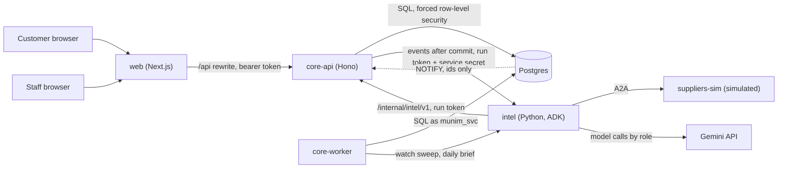
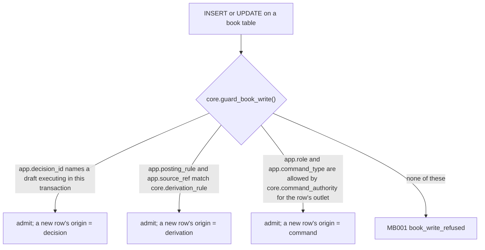
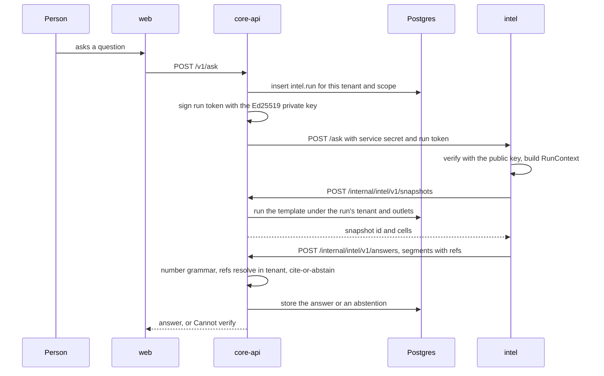
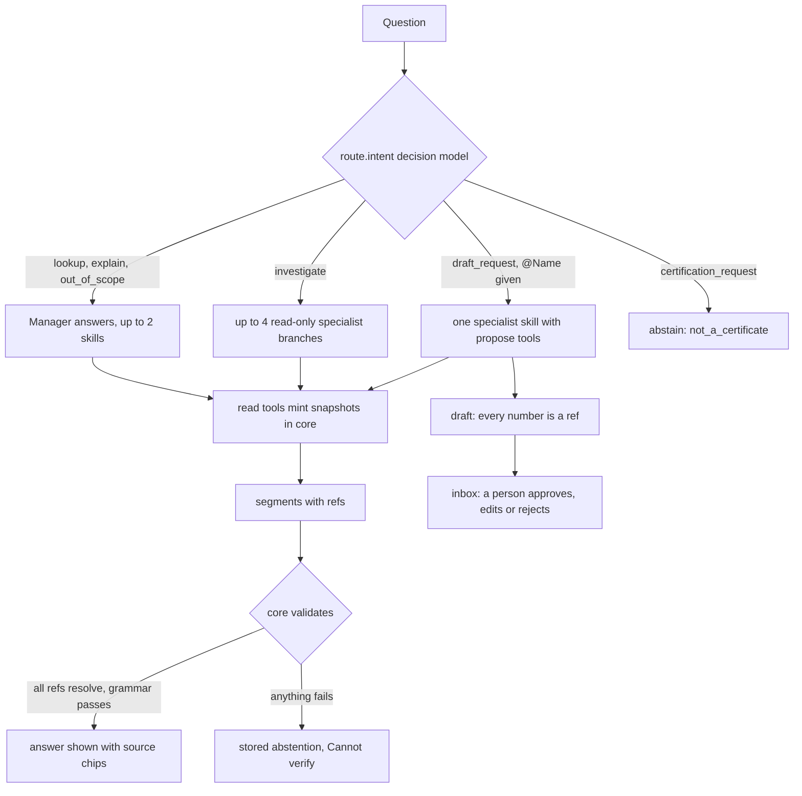
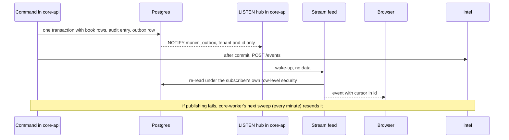
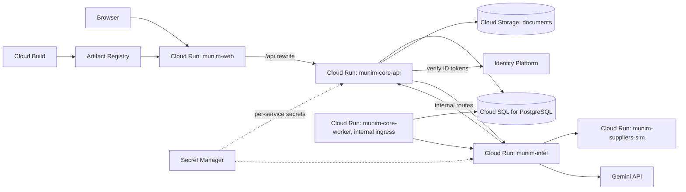

# Munim: architecture

How the system is built and how it runs on Google Cloud. The runtime contract is the code: the SQL migrations in
`db/migrations/` and the zod schemas in `packages/contracts/`. This page explains them. Detail pages are in
[`docs/`](./docs/): [data model](./docs/data-model.md), [API](./docs/api.md), [AI agents](./docs/ai-agents.md),
[security](./docs/security.md), [testing](./docs/testing.md), [decisions](./docs/decisions.md),
[simulation policy](./docs/simulation-policy.md), [glossary](./docs/glossary.md).

All data is synthetic. Suppliers are simulated agents. Payments are recorded, never processed.

## The guarantee

> Nothing changes the books without a named person's approval, and every number shown traces to a ledger row.

- *The books* are every record the business keeps: ledgers, stock, prices, the catalogue, rosters and payroll, customers,
  and messages to customers, staff or real outside parties. Platform configuration changes are approved drafts too.
- *Traces to a ledger row* means a number on screen is rendered from a SQL snapshot cell that core-api minted, never
  typed by a model. A number that cannot be traced is shown as "Cannot verify".
- Nothing the AI proposes applies itself. It writes a draft; a person approves, edits or rejects it.

The sections below show where the code holds that line.

## Services and data flow



| Service | Stack | Job |
|---|---|---|
| `web` (`apps/web`) | Next.js App Router, TypeScript | The Cobnut Bakehouse storefront and the staff screens. Calls core-api only through the SDK (`packages/sdk`), on its own origin: `/api/*` is rewritten to core-api. |
| `core-api` (`services/core-api`) | Hono on Node, TypeScript | The system of record and the **only writer of Postgres**. Public `/v1`, internal `/internal/intel/v1`, operator `/platform/v1`, server-sent events on `/v1/stream`. Publishes each transaction's events right after commit. |
| `core-worker` (`services/core-worker`) | Node, TypeScript | One long-running process, logged in as `munim_svc`: outbox sweep (every minute), watch fan-out (every 15 minutes), each tenant's daily brief (06:00 local time), import parsing, Auto investigation steps. Exactly one instance. |
| `intel` (`services/intel`) | Python 3.12, Google ADK 2.11 | The Manager and eight specialists. **No database client**; every write goes through core-api's internal routes. |
| `suppliers-sim` (`services/suppliers-sim`) | Python, A2A | Three **simulated** supplier agents. Every card and reply says "Simulated supplier". |

Shared code: `packages/contracts` (zod schemas, from which the OpenAPI documents, JSON Schema and intel's Pydantic models
are generated), `packages/core-domain` (money, time zones, the country-pack engine, posting rules, command authority, the
answer grammar), `packages/config` (the one config module), `packages/sdk`.

## The book guard

Every `core` table is tagged `munim:book` (105 tables) or `munim:operational` (32) in a table comment. Two layers guard
the books.

1. **Grants.** Of the roles that log in, only `munim_core` may insert or update a book table. (The no-login role that owns
   the cross-tenant functions holds a few column updates, such as a merged customer's `merged_into`; the trigger still
   runs on them.) `munim_svc`, which serves intel's internal routes and core-worker, has no book grant, so a service write
   fails with `42501` before any trigger runs.
2. **Trigger.** `core.guard_book_write()` runs before every insert or update on a book table.



- **Command authority.** `core.command_authority` lists, per command type, the roles allowed, the scope (tenant, outlet,
  or the person's own record or order) and the tables the command may write. A command that tries another table fails
  with `MB008`.
- **Approved decision.** The draft must be `executing` in this very transaction and its decision must be approved or
  edited. Replaying a decision id from a later transaction is refused.
- **Posting rule.** A deterministic derivation of an approved row, such as consuming stock for an order or posting a
  journal entry, named in `core.derivation_rule` (`db/derivation-rules.json`).

There is no bypass for any role, including the migration owner. Every command and approved draft writes an entry to
`core.audit_log`, a per-tenant hash chain. Journal entries balance per currency at commit (`MB010`). No role has `DELETE`
on any table; corrections are reversals or voids with a reason and an actor. [`docs/data-model.md`](./docs/data-model.md)
has the tables.

## Commands, events, drafts

- **Command:** `{command_id, idempotency_key, type, payload}`, typed `<module>.<verb>.v<N>`. Tenant and actor come from
  the verified identity, not the body. The same key with the same request returns the stored result (with
  `X-Munim-Replayed: true`); the same key with a different request is `409`.
- **Event:** CloudEvents 1.0, `munim.<module>.<entity>.<verb>.v<N>`, written to `core.outbox` in the command's own
  transaction. After commit, the same request publishes it to intel's `/events`; core-worker resends anything left
  unpublished. Delivery is at least once and intel claims each event id once.
- **Draft:** a proposed command with its evidence refs and the snapshots it is based on. Approval is a conditional
  status update (exactly one winner), re-checks the approver's authority on the final payload, re-runs every snapshot
  the draft is based on (a changed number marks the draft `stale`), then executes the command as the approver and
  writes the audit entry, all in one transaction.
- **Imports are drafts too:** upload, preview (rows, totals, quarantined lines), approval, then commit under the approver.
  A mapping is renames and units only, with no arithmetic.

## Run tokens: how intel gets a tenant without writing



- core-api mints an Ed25519-signed token `{iss, aud, run_id, tenant_id, outlet_scope, trigger, actor, iat, exp}` and
  records the run. It lives 15 minutes for an ask, 30 for an ingest and two hours for events, sweeps, briefs and Auto
  investigation steps.
- intel holds only the public key, so it cannot mint one. On every internal call core-api checks the signature and the
  run row; the tenant and outlet scope come only from the token. No intel tool takes a tenant argument.
- Internal routes need the service secret as well as the run token.

## The AI layer



- **Router and specialists.** A decision model picks one of six intents, each mapped to one of four paths. Eight
  specialists are skills (instructions plus generated tools): Menu & Pricing, Kitchen, Stock & Purchasing, Finance,
  People, Customers, Compliance, Market. A leading `@Name` addresses one. Details: [`docs/ai-agents.md`](./docs/ai-agents.md).
- **Tools close over the run context.** A tool is built per run around the verified `RunContext`. No tool schema has a
  tenant, run or actor parameter, and a test reflects over every tool to prove it.
- **Snapshots and cells.** A `read_*` tool asks core-api to run an allow-listed SQL template under the run's row-level
  security. Core stores the rows and a SHA-256 in `evidence.snapshot` and returns ids. That is the only way a number
  reaches intel. The model writes handles such as `{S1.r0.net_minor}`; code expands them to refs.
- **Refs and the grammar.** `⟨snap:<id>·<row>·<column>⟩` is a value and `⟨cite:<kind>:<id>⟩` is a source. Model prose may
  not contain a digit of any script, a percent sign, a number word or a typed quotation outside a ref. Core validates
  every answer, finding and narration. On failure it stores an abstention with a reason code and shows "Cannot verify",
  composed from its own text.
- **Drafts from intel.** Every number in a proposed draft is a ref (snapshot cell, quote row or document span), shown
  beside the value. A person's edit is labelled `{value, typed_by}`.
- **Untrusted text.** Supplier replies and uploaded documents are read by an extractor call that has no tools. Once a run
  has read untrusted text it may no longer propose a draft.
- **Traces.** Every step (route, skill load, tool call, A2A message, finding, draft, abstain) is a trace event with ids
  and short labels only. They are flushed before intel answers, and the staff screens replay them.

## Live models and the recorded fallback

Each model role (`router`, `reason`, `extract`, `narrate`, `vision`, `embed`) is a row in `platform.model_role`: a
provider, a model id and a price. Migration 0015 seeds Gemini ids; an operator changes a role through an approved config
draft. The database refuses any id matching `gemini-2.5`. ADK's native Gemini class serves Gemini roles; ADK's
OpenAI-compatible class serves other providers.

| `MUNIM_MODEL_MODE` | Behaviour |
|---|---|
| `live` | The provider is called. A Gemini call that fails with a 5xx or a 429 is started over at most twice (a 429 at most once), after a jittered wait and within the role's timeout; a timeout is never retried. If the call still fails or times out, or the business's monthly AI budget is spent (then no provider call is made), the recorded answer for that exact request is served when a fixture exists; otherwise the caller degrades (an ask abstains, a narration keeps its template, a watcher keeps template wording). A role with no operator price is refused before any call and degrades the same way. |
| `recorded` (default) | Every call is served from a committed fixture keyed by a hash of the request. A missing fixture is an error that names the key, never a fall-through to a live model. All tests run this way and need no key. |

AI surfaces degrade to hidden or template text, never to an error state. The kill switch is one typed platform flag,
`intel.enabled`, changed only through an approved config draft; a per-business monthly cap stops live calls when it is
reached.

## Outbox, LISTEN/NOTIFY, SSE



`GET /v1/stream?topics=kds:<outlet>,inbox:<tenant>,trace:<run>,order:<id>` serves four topic kinds. The cursor in `id:` is
resumed through `Last-Event-ID`. Clients use fetch-based SSE so the bearer token travels in a header. A heartbeat is sent
every 20 seconds and the server ends the stream before Cloud Run's 60-minute request cap with a reconnect hint.
Three channels carry notifications: `munim_outbox`, `munim_inbox` (drafts, findings, investigations) and `munim_trace`.

## Multi-tenancy

- Every tenant table has **forced** row-level security and leads its keys with `tenant_id`. A transaction states its
  context with `SET LOCAL app.*` (tenant, outlets, role, member, command type, decision, and more). The tenant comes only
  from a verified identity or a verified run token.
- The runtime roles are `NOSUPERUSER NOBYPASSRLS` and own no tables. One `NOLOGIN BYPASSRLS` role owns the few objects
  that must cross tenants (listed as `CROSSTENANT_OBJECTS` in `db/tests/manifest.ts`).
- A request for another tenant's id, or with a bad storefront key, answers `404`. [`docs/security.md`](./docs/security.md)
  has the controls.

## Country packs

No code path branches on the country. A pack is a versioned JSON document (`packages/contracts/packs/IN.json`, `AU.json`)
seeded into `platform.country_pack`: currency, time zones, financial-year start, tax classes and rounding, tax
identifiers, invoice rules, aggregator formats, payroll scope, licence kinds, cash rounding, detector thresholds and a
chart of accounts. India is live (INR, `Asia/Kolkata`, payroll drafts). The Australia pack is complete data (AUD,
`Australia/Melbourne`, financial year from July, roster only) and is exercised by the tests; the demo business is Indian.
A business's country, currency and financial year are fixed once it is onboarded. Money is integer minor units plus a
currency. Time is `timestamptz` with IANA zones from the pack, through one tz module.

## Sign-in

| Who | Identity | Authorisation |
|---|---|---|
| Staff and owners | Identity Platform ID token (RS256, Google's published keys) | `core.membership` (role, outlets) and `core.command_authority`; roles never come from the token |
| Customers | storefront key, optional customer token | their own orders only |
| Guests | storefront key and a guest token | one order, read only |
| Operators | Identity Platform, listed in `platform.operator` | `/platform/v1` only |
| intel to core-api | service secret **and** a run token | the run's tenant and outlets |

The demo site offers four demo people (owner, manager, counter, kitchen) on a synthetic bakery. The web server signs them
in with Identity Platform's password grant (`apps/web/lib/server/demo-session.ts`). The shared demo password never reaches
a browser.

## Deployment on Google Cloud

Region `asia-south1` (Mumbai). Images are built by Cloud Build into Artifact Registry and deployed by
`scripts/deploy-gcp.sh`. The runbook is [`infra/gcp/README.md`](./infra/gcp/README.md).



| Cloud Run service | Instances | Notes |
|---|---|---|
| `munim-web` | 0 to 2 | The only entry people open; its `/api` rewrite carries SSE to core-api. |
| `munim-core-api` | exactly 1, CPU always allocated | Holds the LISTEN connection behind `/v1/stream`. Streams end at 3300 s (`MUNIM_STREAM_MAX_AGE_S`), under the 3600 s cap. |
| `munim-core-worker` | exactly 1, CPU always allocated, internal ingress | The outbox sweep and scheduled jobs. A job still running skips its next boundary. If two workers overlap during a rollout, the outbox sweep's advisory lock and `FOR UPDATE SKIP LOCKED` leases keep one sender per row, and core's event claim lets intel handle each event once. |
| `munim-intel` | 0 to 3 | No database. Every route but `/health` needs the service secret. |
| `munim-suppliers-sim` | 0 to 2 | Simulated suppliers. Holds no secret and no data. |

- **Cloud SQL** for PostgreSQL (`--edition=ENTERPRISE`, `db-g1-small`): public IP with no authorised networks, reached
  through Cloud Run's built-in Cloud SQL connection. The connection budget is core-api 9, core-worker 6 and one for
  migrations, doubled for a service during its rollout, which is why the tier is `db-g1-small`.
- **Cloud Storage** holds uploaded documents as `<tenant>/<sha256>` objects in one private bucket, through the adapter in
  `adapters/gcp/`.
- **Identity Platform** verifies staff, customer and operator tokens (`adapters/gcp/idp-identity-platform`).
- **Secret Manager** holds the database role passwords, the service secret, the run-token key pair, the Gemini key, the
  Identity Platform web API key, the storefront key and the demo password. Each service account reads only its own
  secrets.
- **Cloud Build and Artifact Registry** build and store one image per service from `infra/gcp/docker/`.

## Failure modes

| Failure | Behaviour |
|---|---|
| intel down | AI panels hide. The inbox and approvals still work, because approval needs only core-api. |
| A model call fails or is over budget | The recorded answer for that exact call if one exists; else an ask abstains and a narration or brief keeps its template text. |
| An answer fails validation | The reason code is stored; the screen shows "Cannot verify". |
| Publishing after commit fails | The outbox row stays unpublished; core-worker resends it. A row that can never be delivered is dead-lettered after five attempts. |
| Duplicate delivery | core's event claim answers intel's repeat claim with `409`; no work repeats. |
| A stale draft | A snapshot it relied on changed; the draft is marked `stale` and shows what changed. |
| The stream drops | The SDK reconnects with `Last-Event-ID`. |
| `/health` | A database round trip on both pools and the migration version; 200 only if both pass. |

## Repository layout

```
apps/web/                 Next.js: the storefront and the staff screens
services/core-api/        src/modules/<module>/ · src/internal/ · src/platform/ · src/stream/ · src/auth/
services/core-worker/     the long-running worker; imports core-api's modules
services/intel/           munim_intel/: manager, decide, skills, tools, context, runtime, events, watch, detect, brief,
                          narrate, negotiate, investigate, fanout, ingest, mapping, wiki, forecast, graph (Postgres
                          edges), trace, llm, contracts_gen
services/suppliers-sim/   three simulated supplier agents
packages/                 contracts, core-domain, config, sdk
adapters/gcp/             Identity Platform and Cloud Storage adapters
db/                       migrations (forward only), the migration runner, role bootstrap, country-pack seed
tools/worldgen/           the Cobnut Bakehouse world: synthetic data seeded through the public API
infra/gcp/                Dockerfiles, Cloud Build files, the Cloud Run entries and the runbook
scripts/deploy-gcp.sh     build and deploy
```

Import boundaries are checked by dependency-cruiser (`.dependency-cruiser.cjs`) and import-linter (`pyproject.toml`): web
imports only the SDK and contracts (plus the Identity Platform sign-in in its server code), core-api modules import each
other only through `index.ts`, and intel imports no other service and no database driver.
