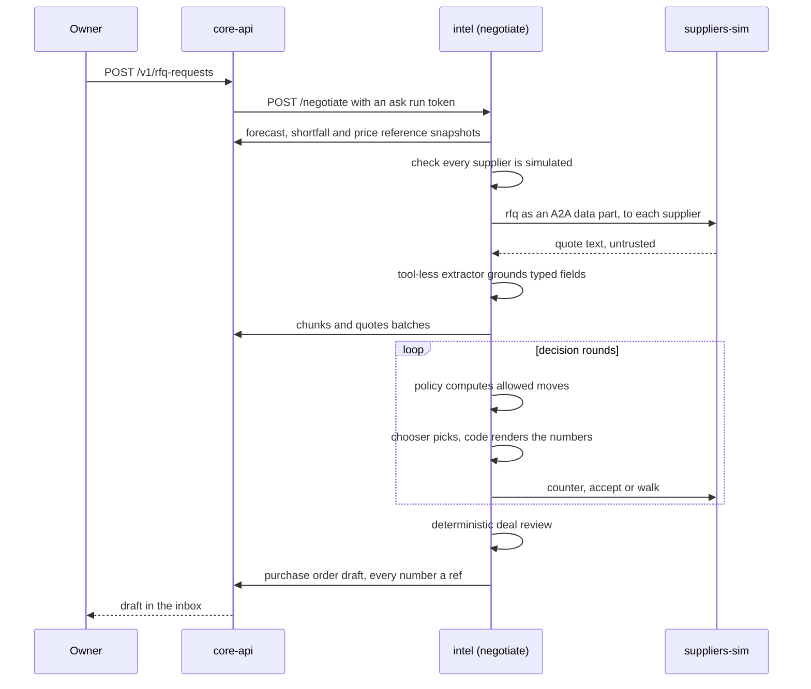

# AI agents

Munim Intelligence is the Python service in [`services/intel`](../services/intel/) (package `munim_intel`), built on Google
ADK 2.11. It is a Manager plus eight specialists. It explains with citations, finds money leaks, and drafts actions. **It
cannot write**: it has no database client, and every output goes to core-api's internal routes, where core validates it.
A person approves every change.

All data is synthetic. Suppliers are simulated. Payments are recorded, never processed.

## HTTP surface

`munim_intel/app.py` serves these routes. All but `/health` need the service secret; every run also needs a run token that
core-api minted.

| Route | Caller | What it does |
|---|---|---|
| `GET /health` | anyone | Liveness and model mode |
| `POST /events` | core-api after commit; core-worker for stragglers | Claims each event id once, then runs the detectors that watch that event type |
| `POST /watch:sweep` | core-worker, every 15 minutes | Runs every registered detector over the run's outlets |
| `POST /brief` | core-worker, per tenant at 06:00 local | Words core's ranked inbox as one stored answer |
| `POST /ask` | core-api (`POST /v1/ask`) | One Manager ask; stores the answer under core's answer id |
| `POST /investigate:narrate` | core-api, core-worker | Narrates one investigation step |
| `POST /negotiate` | core-api (`POST /v1/rfq-requests`) | The supplier negotiation |
| `POST /ingest` | none yet | Validates an ingest run token only. No route in core-api hands intel a document yet, so nothing is read or written here. |
| `POST /smoke` | tests | One trivial recorded run through the echo tool |

Request bodies are parsed by hand, so no framework validation error ever echoes a request. Every refusal of a caller is the
same `401`. No response carries model text, a token or an exception message.

## The Manager and the router

`POST /ask` runs `munim_intel/manager/ask.py`:

1. An `@Name` that addresses a specialist off for every outlet kind in scope (the kitchen on a shop-only business)
   abstains `not_applicable`, with no model call.
2. If AI is off or the month's budget is spent, the ask abstains `model_blocked`, with no model call. Over the monthly cap
   with AI on in live mode, calls are served from recorded fixtures or abstain.
3. `route.intent`, a constrained decision model, picks one of six intents, and each intent maps to a path. It sees only
   the question, the outlet kinds and the country, and it picks an intent, never a specialist.
4. Otherwise one Manager agent runs over the loaded skills and ends by calling `submit_answer`.

| Intent | Path |
|---|---|
| `lookup`, `explain`, `out_of_scope` | The Manager answers, loading at most two skills (or the addressed specialist's skill, loaded in code). |
| `investigate` | With a scored routing guess and no `@Name`: up to four read-only branches, one per specialist, run concurrently, each in its own ADK runner with its own budget. If the guess is unscored, the Manager answers alone and offers a "dig deeper" follow-up; tapping it fans out whatever the score. With an `@Name`, that specialist answers alone. |
| `draft_request` | Exactly one specialist's skill, loaded in code, with its `propose_*` tools. Without an `@Name` the answer abstains `specialist_needed`, and the console offers the specialists to mention. |
| `certification_request` | A fixed abstention, `not_a_certificate`, with no model call. |

A run that ends without a submitted answer stores an abstention (`missing_ref`), which the screen shows as "Cannot verify".

## The eight specialists

A specialist is a skill: hand-written instructions plus tools generated from
[`packages/contracts/generated/ontology.json`](../packages/contracts/generated/ontology.json). One `read_<template>` tool
mints a snapshot through core. One `propose_<command>` tool posts a draft, only on a draft request. The registry, with the
exact template and command lists, is
[`packages/contracts/src/intel/specialists.ts`](../packages/contracts/src/intel/specialists.ts). Instructions contain no
digits, so every figure an answer shows is a cell the specialist cites.

| Specialist (`id`) | Answers | Reads (snapshot templates) | May propose | Detectors |
|---|---|---|---|---|
| Menu & Pricing (`catalogue`) | True dish margins, prices, deals, MRP ceilings | `dish_margin`, `menu_matrix`, `cost_drift`, `deal_cost`, `sku_price_check`, `recipe_current` | `catalogue.price.set`, `catalogue.recipe.version.create`, `catalogue.deal.end` | negative margin, cost drift, recipe waste gap, deal loss, above MRP, below cost |
| Kitchen (`kitchen`) | Ticket times, remakes and over-prep, prep needs | `ticket_times`, `ticket_drift`, `remakes_overprep`, `prep_need`, `ticket_coverage` | `kitchen.prep_time.set`, `kitchen.prep_list.create` | ticket drift, remakes, over-prep, prep time gap |
| Stock & Purchasing (`inventory_purchasing`) | Stock, shortfalls, waste, expiry, shrinkage, supplier prices and invoices | `below_reorder`, `shortfall`, `waste_week`, `expiry_risk`, `shrinkage`, `dead_stock`, `price_creep`, `invoice_vs_po`, `quote_compare`, `invoices`, `counts`, `count_variance` | `purchasing.po.create`, `purchasing.invoice.dispute`, `purchasing.supplier_return.create`, `inventory.reorder_level.set`, `inventory.transfer.create` | shortfall, waste spike, expiry risk, shrinkage, dead stock, price creep, overbilled, near-duplicate invoice |
| Finance (`finance`) | Payouts against orders, unapproved deductions, counter payments against the bank, profit, tax checks, month-end close | `unapproved_deductions`, `settlement_vs_orders`, `missing_payouts`, `tender_vs_bank`, `pnl`, `gst_check`, `close_status`, `margin_bridge`, `gst_summary` | `finance.dispute.draft`, `finance.journal.adjust`, `finance.period.close` | unapproved ad fee, short payout, missing payout, tender gap, tax mismatch |
| People (`people`) | Hours against demand, overtime, labour cost, advances | `labour_vs_demand`, `overtime_drift`, `labour_pct`, `attendance_coverage`, `advances_open`, `payroll_lines` | `people.roster.create`, `people.payroll_draft.create` (payroll only where the pack prepares it) | overtime drift, overstaffed slot, high labour percentage, unrecovered advance |
| Customers (`customers`) | Coupon leakage, regulars at risk, reviews, consented audiences | `coupon_leakage`, `staff_coupon_use`, `coupon_daily`, `churn_segments`, `review_trend`, `consented_audience`, `coupon_current` | nothing from a model | coupon cap evasion, staff-applied coupon, coupon spike, regulars lapsing, rating drop |
| Compliance (`compliance`) | Licence calendar, log coverage, temperature excursions, equipment cost | `licence_calendar`, `log_coverage`, `temp_excursions`, `asset_costs`, `energy_per_order` | `goals.task.create`, `compliance.maintenance.schedule` | licence expiring, missed logs, temperature excursion, contract waste, overdue maintenance, energy drift |
| Market (`market`) | Upcoming events and their measured effect, competitor price gaps, goals, whether a new site would pay back | `signal_uplift`, `upcoming`, `competitor_gap`, `viability`, `goal_progress`, `goal_baseline`, `goals`, `cares.listings`, `cares.impact` | `goals.goal.create`, `goals.task.create` | event ahead, competitor undercut, goal off track |

Each specialist also has refusals written into its skill, using reason codes. Examples: Compliance refuses to say an
outlet is "compliant" or "audit-ready" (`not_a_certificate`) and refuses to say a fridge stayed in range when no readings
exist (`log_coverage_missing`); Finance refuses a month's profit until settlements are imported (`settlements_missing`);
Stock & Purchasing refuses to measure missing stock without a completed count (`count_missing`); Kitchen refuses a
ticket-time answer when too few tickets were timed (`ticket_times_missing`); Market refuses a weather or festival claim
that was not imported (`signal_source_missing`).

A **Forecast** service (`munim_intel/forecast/`) is shared, deterministic and has no desk. It turns per-outlet, per-item
sales history into daily demand points. In this build the negotiation runs it (below), and the forecast-reading templates
(prep need, shortfall, expiry risk, deal inputs, upcoming events) read the latest forecast run.

Some drafts are not model tools. Deterministic mapping code (`munim_intel/mapping/`) turns a detection into a draft whose
every leaf is a ref, an id, pack data or a date chosen from the business date. Examples: a donation listing for stock about
to expire, a win-back campaign for lapsing regulars (accepted by core only on a demo business), and a task to hand over an
overstaffed slot.

## Tools, handles and the run context

- A tool is built per run around `RunContext` (`munim_intel/runtime/context.py`), which is built only from a verified run
  token. No tool schema has a tenant, run or actor parameter; `tests/test_tools.py` reflects over every registered tool and
  fails on one.
- Cells have handles: `S<n>.r<i>.<column>`. The model writes `{S1.r0.net_minor}`; code expands it to
  `⟨snap:<id>·0·net_minor⟩`. An id cell used as an argument is expanded to its value, so the model never types a UUID.
- One handle table is shared by the Manager and every branch of a run.
- A context may declare at most 20 tools and load at most two skills. A mid-run `load_skill` is bound because the toolset
  turns off ADK's per-invocation tool cache.
- Error text the model sees is fixed English with handle paths, column names and reason codes. It never carries a cell
  value, a raw body or an exception message.

## Cite or abstain

`submit_answer` ends a Manager run. Each segment is rendered through the handle table and checked by the number grammar
(no digit, number word, percent sign or typed quotation outside a ref) and by "every segment cites at least one cell".
A failure gets one retry, then an abstention with the rule's code. Core then validates the posted envelope again
(`packages/core-domain/envelope/validator.ts`): grammar, at least one declared ref per segment, every ref resolves in the
run's tenant, quotation spans fit their source. `tests/tools/test_grammar_parity.py` runs intel's port of the grammar and
core's over one table of probes and requires the same verdict.

## Untrusted text and taint

Supplier replies are untrusted. A reply enters one context only: a single extractor call with no tools and a JSON response
schema (`munim_intel/ingest/quarantine.py`). The run is marked tainted before the call. A tainted run keeps its `propose_*`
tools bound, but the plugin refuses each call. Graph tools taint the run when they return rows, because an entity name can
come from a document. A response that tries a function call is refused whole.

## Watchers, findings and the daily brief

- A detector reads a snapshot per outlet, applies thresholds from the country pack, and posts a finding to core. The
  finding's impact is a snapshot cell. Severity comes from the pack's ladder by impact. A re-detection merges into the same
  open finding.
- Narration is template text with refs by default (it has no digit of its own). A model writes it in one call with no tools,
  only for `high` or `critical` findings and only when the run's frame allows. A line that fails the grammar leaves the
  template in place.
- The brief: core ranks open findings (impact, confidence, urgency, de-duplicated, drafts attached). intel words them with
  template text, and at most one model call for the whole brief. It is posted as one stored answer.
- The kill switch is the platform flag `intel.enabled`. A business's monthly cap is the lower of the owner's cap and the
  operator's limit. Either stops live model narration; template wording remains. Over the cap with AI on, in live mode, a
  call is served from its recorded fixture when one exists, else the template stays.

## Investigations

`POST /v1/investigations` opens a playbook. There is one, `margin_fall` ("why did margin fall between two months"), defined
as data in `packages/core-domain/investigations/playbooks.ts`. It has a data-completeness gate (till sessions closed,
settlements imported, bank lines imported) and six hypotheses: supplier prices, waste, deals and discounts, channel fees,
labour, and volume and mix. Each belongs to a specialist.

- **Core decides.** For each step core mints each item's snapshot, evaluates the verdict in code (`supported`, `refuted` or
  `cannot_verify`) and computes the status. No model sets a verdict or a status. When every hypothesis is judged and none
  is supported, or the residual they leave unexplained is too large, the investigation ends as `no_driver_found`.
- **intel narrates.** After the step commits, core asks `/investigate:narrate`: one call, no tools, one line per changed
  item, each citing only its own cells. If intel is down or over budget, core stores its template sentence.
- **Modes.** Step runs one step per request. Plan runs the steps in one request after the creator approves a plan. Auto is a
  Plan that core-worker resumes when new data lands, under a standing grant that only the creator can give. Each role has a
  ceiling (defaults: owner Auto, manager Plan, staff Step), changed only by the owner. A lowered ceiling downgrades an
  Auto investigation to Plan and stops a Plan run; losing access to its outlets cancels it. Plan and Auto stop when the
  month's AI budget is spent.
- Investigations create no drafts and write no book.

## Negotiation with simulated suppliers

`POST /v1/rfq-requests` records a person's command. Core mints an ask run scoped to the outlets they chose and calls
`/negotiate`. The workflow lives in `munim_intel/negotiate/`.

- **Before anything is sent**, each supplier is checked: its row is of kind `simulated`, its agent card and every interface
  the card advertises are on the configured simulator origin (`SUPPLIERS_SIM_PUBLIC_URL`), and the card's name carries
  "Simulated supplier". One failure refuses the whole negotiation. The database enforces the same rule (only a simulated
  supplier may carry an agent card, and a quote can reference only a simulated supplier).
- **The quantity** is the cell `inventory.shortfall.shortfall_qty_milli` at the lead time. No shortfall means no supplier is
  contacted and no model is called. **The reference price** is the lowest last price any supplier holds
  (`purchasing.price_creep`).
- **The policy** (`policy.py`) computes the allowed moves and a default for each open supplier. A counter price is the best
  rival's price if lower, else the owner's target. Target and walk-away are the owner's business policy, in basis points of
  the reference price; the defaults are 95 percent and 110 percent. After the allowed number of counters only accept or walk
  remain, so the run ends by itself.
- **The chooser** is one model call per round with no tools. It picks a move per supplier from the allowed set and writes a
  short note. It types no price; a note that breaks the number grammar is replaced by a template note.
- **Extraction** binds each typed field (unit price, quantity, minimum order, payment days) to its own place in the reply.
  Any number the fields do not claim drops the quote (`unbound_number`).
- **Deal review** (`review.py`) is five deterministic rules over a snapshot per accepted quote: budget, margin floor, minimum
  order against need, overlap with open commitments, payment terms. Each returns pass, fail with a code, or cannot verify.
  At most one purchase-order draft results. Its quantity and price are refs to the negotiation's
  `purchasing.quote_compare` cells, and each quote keeps the reply as an untrusted chunk with the span each field was read
  from.
- `suppliers-sim` ([`services/suppliers-sim`](../services/suppliers-sim/)) serves three agents, `steady`, `discounter` and
  `premium`, each at `/<key>` with a card at `/<key>/.well-known/agent-card.json`. Their personalities are data
  (`personalities.json`), so the same request gets the same reply. Inputs are bounded and offers expire.

## Traces

Every run emits trace events: `route`, `skill_load`, `subagent_start`, `subagent_end`, `tool_call`, `tool_result`,
`a2a_send`, `a2a_receive`, `finding`, `draft`, `abstain`, `error`, `review`. Payload values are single tokens of at most 200
characters; prose cannot pass, and an attempt fails the run instead of shipping text. The `MunimPlugin` covers all 14 ADK
plugin callbacks, and a test requires each to fire at least once over a scripted run and three planted error runs. Traces
flush before intel responds, including on failure, and every provider call is posted as a spend row.
`GET /v1/traces/{run}` and the `trace:<run>` stream topic serve them, and the staff "office" screens replay them.

## Models

Each role is a row in `platform.model_role`: `router` (route.intent), `reason` (the Manager, branches and the negotiation
chooser), `extract`, `narrate`, `vision`, `embed`. Migration 0015 seeds Gemini ids, and an operator changes a role through
an approved config draft. A role names its provider: Gemini through ADK's native class, or OpenRouter or NVIDIA through
ADK's `OpenAILlm` with that provider's base URL and key. A role must have a price to run live. The database refuses a model
id that matches `gemini-2.5`. With `MUNIM_MODEL_MODE=recorded`, `RecordedLlm` serves every call from a fixture in
`services/intel/fixtures/recorded/`, keyed by a hash of the request with UUIDs normalised; a miss is an error naming the
key. In live mode each call has a per-role timeout. A Gemini call that fails with a 5xx or a 429 starts over at most
twice in all, and at most once for a 429, after a jittered wait (a base of half a second, then one second, for a 5xx; two
seconds for a 429). The retries spend the role's own timeout, and a timeout is never retried. A call that still fails is
served from its recorded fixture when one exists; otherwise the caller degrades (an ask abstains, narration keeps its
template).

## Built, but not reached from a route

These have code and tests but no caller in this build: document and chat ingestion and the invoice reader
(`munim_intel/ingest/`, apart from the extractor the negotiation uses), the wiki compiler (`munim_intel/wiki/`), and the
graph projector (`munim_intel/graph/project.py`). The graph tools on the Menu & Pricing and Stock & Purchasing skills read
whatever entities and edges the database holds; nothing in this build fills `intel.edge` yet.
