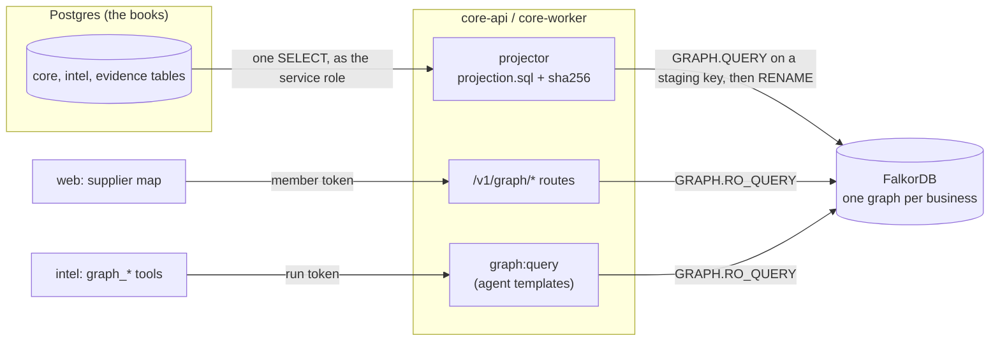

# Architecture

Munim has two parts. **Munim Core** (TypeScript, Hono, Postgres) is the deterministic system of record: it holds the books,
takes orders, checks permissions and publishes events, behind one public API, `/v1`. **Munim Intelligence** (Python, Google
ADK) is a Manager and eight specialists that explain, find leaks and draft actions; they never change anything themselves.
In this build the supply chain of each business is also a **FalkorDB graph**, which core builds from the books and every
"what does this touch" question reads.

This page is the map. The parts that do not depend on the graph (tenancy and row-level security, the book guard, commands,
events and drafts, live updates, country packs) are in [`docs/core-architecture.md`](./docs/core-architecture.md); the AI
layer is in [`docs/ai-agents.md`](./docs/ai-agents.md); the graph's nodes, edges and build are in
[`docs/graph-model.md`](./docs/graph-model.md), and its queries in [`docs/cypher.md`](./docs/cypher.md).

## Processes

| Process | Code | Job |
|---|---|---|
| Web app | `apps/web` | Storefront and staff screens, including the supplier map. Calls the API only through `packages/sdk`, on its own origin (`/api/*` is rewritten to core-api). |
| core-api | `services/core-api` | The system of record and the only writer of Postgres. The only writer of the graph, too: it rebuilds a business's graph from the books before every graph read. Public `/v1`, internal `/internal/intel/v1`, operator `/platform/v1`, server-sent events on `/v1/stream`. |
| core-worker | `services/core-worker` | One long-running process: the outbox sweep, watches, the daily brief, import parsing, and `graph-project`, which brings every active business's graph up to date every 15 minutes and clears staging graphs that a build left behind. |
| intel | `services/intel` | Python, Google ADK. The Manager and eight specialists. No database client and no FalkorDB client: it reads the books through snapshots core mints, and the graph through core's read-only `graph:query`. |
| suppliers-sim | `services/suppliers-sim` | Three simulated supplier agents over A2A. |
| Postgres | `db/migrations` | The books. One database, four application schemas (`core`, `evidence`, `intel`, `platform`) and a read-only view schema (`intel_ro`). |
| FalkorDB | `adapters/falkordb` | One graph per business, `munim:<tenant id>`, rebuilt from the books. Holds no number to show and no personal data. |

## The graph path

- **Who writes what.** core-api and core-worker write Postgres (core's own role for commands, a service role with no book
  grant for internal routes and jobs) and the graph (the projector, as that service role, which reads the books and writes
  only FalkorDB). intel writes nothing directly: its only write path is `/internal/intel/v1`, and no route there writes the
  graph. intel has no FalkorDB client and reads no graph setting (on Vercel, where the API project's three services share
  one set of environment variables, `MUNIM_FALKORDB_URL` is in intel's environment too, unread). The graph is a derived read model; it is never a source for the books.
- **Freshness.** Every graph read first runs the projection statement and compares its checksum with the one stored on the
  graph; only a difference rebuilds. So a graph answer always matches the books at the moment it is read, and a business
  whose books have not changed costs one SELECT per read.
- **Reads are read-only by construction.** Every read is `GRAPH.RO_QUERY` with static query text and parameters, with a
  1-second server timeout; FalkorDB refuses a write sent that way.
- **Tenancy.** core builds the graph key from the tenant it verified (a member's sign-in or an agent's run token). No query
  text, parameter or tool argument names a tenant, so a query cannot reach another business. The outlet scope reaches each
  read as `$outlets`, from the membership or the run token.

## The graph-backend port

core-api names no graph database. It holds one port, `GraphBackend`
([`services/core-api/src/internal/graph/port.ts`](./services/core-api/src/internal/graph/port.ts)):

| Member | What it does |
|---|---|
| `template(name, args, caller)` | One of the agents' templates, arguments already checked by core; `null` when this backend does not serve it |
| `fresh(caller)` | Brings the caller's business graph up to date with the books; returns when it was built and whether it wrote |
| `read(name, params, caller)` | One of the route reads (`ingredient`, `ingredient_reach`, `ingredient_sources`, `supplier`, `supplier_reach`, `sole_sources`, `findings_about`, `drafts_about`) |
| `cleanup(now)` | Deletes staging graphs older than an hour |

The FalkorDB adapter ([`adapters/falkordb/src/index.ts`](./adapters/falkordb/src/index.ts)) implements it.
`packages/config` finds the adapter by path (`adapters/<name>/env.ts` exporting `graphEnv`): it adds the mode `falkordb`
and the variable `MUNIM_FALKORDB_URL` (`redis://` or `rediss://`), which config treats as a secret and redacts from every
log line. `MUNIM_GRAPH` names the backend; in this build the only one is `falkordb`, so it is also the default, and
`MUNIM_GRAPH=postgres` refuses at boot with "no graph backend postgres in this build".

A backend that cannot answer throws `GraphUnavailable` with a fixed label (`unreachable`, `timeout`, `error`,
`short_write`); core answers `503 graph_unavailable` and logs the label only. The client connects with a 2-second timeout,
never queues a command while disconnected, and connects again on the next use.

## Routes and tools

| Surface | Route | Who | Runs |
|---|---|---|---|
| Public | `GET /v1/graph/ingredients/{id}` | owner, manager, judge | `ingredient`, `ingredient_sources`, `ingredient_reach`, then `findings_about` and `drafts_about` over the ingredient, its dishes and its suppliers |
| Public | `GET /v1/graph/suppliers/{id}` | owner, manager, judge | `supplier`, `supplier_reach` (folded per ingredient), then `findings_about` and `drafts_about` |
| Public | `GET /v1/graph/sole-sources` | owner, manager, judge | `sole_sources` |
| Internal | `POST /internal/intel/v1/graph:query` | intel, with a run token | one agent template: `price_shock_path`, `dish_margin_drivers`, `supplier_dependency`, `neighbourhood` |

- The public routes ([`services/core-api/src/modules/graph/index.ts`](./services/core-api/src/modules/graph/index.ts)) take
  the outlet scope from the membership, never from the request. Each response is parsed against its contract
  (`packages/contracts/src/graph/index.ts`), so no field the contract does not name, least of all a number, leaves core.
  Staff are refused (`403`); an id the graph does not hold is `404`.
- `graph:query` ([`services/core-api/src/internal/graph/index.ts`](./services/core-api/src/internal/graph/index.ts)) accepts
  only the template's one id argument (a uuid) and, for a walk, `depth` 1 to 3 (default 3); any other key, a `tenant_id`
  above all, is `422 invalid_payload`, and so is `claim_support`, which this backend does not serve.
- intel's tools ([`services/intel/munim_intel/graph/tools.py`](./services/intel/munim_intel/graph/tools.py)) are bound by the
  Stock & Purchasing specialist (`graph_supplier_dependency`, `graph_price_shock_path`) and by Menu & Pricing
  (`graph_dish_margin_drivers`, `graph_neighbourhood`). The model passes handles, never uuids: a node the graph returns
  becomes `G<n>`, or, when a snapshot in the same run already holds that id, that snapshot cell's path, so the answer can
  cite the books' number for the dish the graph reached. A run that has read graph rows is marked tainted and cannot propose
  a draft or ask for quotes in the same run, because a name in a row may be text that a person or an imported file put
  there. While the graph is down the
  tool tells the model it is offline; nothing answers in its place.

## Acting on the graph

The supplier map's "Ask other simulated suppliers to quote" is the existing `POST /v1/rfq-requests`. intel's negotiation
asks the simulated suppliers over A2A, counters within the owner's target and walk-away, and a deterministic deal review
ends in a purchase-order draft. Its quantity and price each carry a reference to the quotes they came from; a named person
approves it, which executes the command as that person in one transaction with its audit entry. A request for quotes to simulated suppliers
is not a change to the books.

## Failure modes

| Failure | Behaviour |
|---|---|
| FalkorDB is down or slow | Every graph route and `graph:query` answers `503 graph_unavailable`; the supplier map shows "The supplier map needs the graph database, which isn't answering right now. Your books are fine; try again in a minute."; the agents are told the graph is offline. Nothing falls back. |
| A rebuild falls short (an edge lost an endpoint) | The staging graph is deleted and the live graph is left as it was; the read that triggered it answers `503`. |
| A rebuild dies before its swap | Its staging key is left behind; the worker deletes staging keys older than an hour. |
| A server error | It is mapped to a label; its text, which can quote parameters, is never passed on or logged. |
| intel is down | AI panels hide; the supplier map, the inbox and approvals still work, because they need only core-api and FalkorDB. |

The rest of the system's failure modes are in [`docs/core-architecture.md`](./docs/core-architecture.md#failure-modes).

## Deployments

- **Local** ([`Makefile`](./Makefile)): an embedded Postgres 18, a FalkorDB server from the pinned build that
  `scripts/dev/fetch-falkordb.ts` fetches, and every service as a local process. The README has the steps.
- **Vercel** ([`deploy/vercel/README.md`](./deploy/vercel/README.md)): the web app as one project; core-api, intel and the
  simulated suppliers as one project of three services; the books in a hosted Postgres; the graph on FalkorDB Cloud through
  `MUNIM_GRAPH=falkordb` and `MUNIM_FALKORDB_URL`. The worker's jobs run from one daily cron call there; graph reads rebuild
  first regardless.

## Boundaries

Import boundaries are checked by dependency-cruiser (`.dependency-cruiser.cjs`) for TypeScript and import-linter
(`pyproject.toml`) for Python. The web app imports only the SDK and contracts; core-api modules import each other only through
their `index.ts`; intel imports no other service and no database driver; only `adapters/falkordb` depends on the FalkorDB
client.
