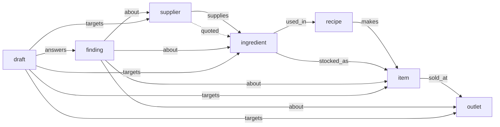

# Business Graph: Munim on FalkorDB

Munim is an operating system for small restaurant groups, cloud kitchens and shops (two to five outlets): the till and a web
storefront, the kitchen board, stock, purchasing, ledgers, rosters, compliance and customers, with an AI layer that explains
what happened, finds money that is leaking and drafts the actions a person might take. **A person approves every change.**

This repository is Munim with its supply chain on **FalkorDB**. Core rebuilds a graph of each business from its books
(suppliers, ingredients, recipes, dishes, outlets, and the open findings and pending drafts on them) and answers every
"what does this touch" question on it: on a screen, through the API, and for the AI agents.

**Track: Agents That Act on Connected Data.** The graph finds the weak point (an ingredient that seven dishes need and only
one supplier sells); from the same screen a person asks other simulated suppliers to quote, an agent negotiates with them
within the owner's limits, and a named person decides: the outcome is a purchase-order draft in the inbox, never an order
placed on its own. Ask Munim's agents read the same graph, and every number they give cites the books (or the answer says
"Cannot verify").

The demo business is **Cobnut Bakehouse**, a synthetic two-outlet bakery in Lucknow. All its data is synthetic and its
suppliers are simulated programs (see [What is simulated](#what-is-simulated)).

## Why a graph

Two questions an owner asks every week are questions about connections, not rows:

- **"What does a price rise of butter touch?"** Butter goes into recipes, recipes make dishes, dishes are sold at outlets,
  and findings and drafts sit on all of them. In the graph that is one walk: `ingredient -used_in-> recipe -makes-> item
  -sold_at-> outlet`, plus the suppliers that sell it and the open findings and drafts about any of those nodes.
- **"Which suppliers can I not afford to lose?"** For each supplier: what it supplies, whether anyone else does, who has
  quoted, and every dish and outlet that depends on it; and across the menu, every ingredient with one supplier on record,
  or none.

Both are answered by FalkorDB, and only by FalkorDB: this build has no other graph. If FalkorDB is stopped, the supplier map
says so, the graph routes answer `503 graph_unavailable`, and the agents' graph tools report the graph as offline. Nothing
falls back to Postgres (`adapters/falkordb/test/core-api.test.ts` stops the server and checks every route).

## The graph data model

One graph per business, keyed `munim:<tenant id>`. Every node's `id` is the id of the book row it came from, so a graph
answer and a snapshot row about the same dish share one id.



| Node | Properties | Built from |
|---|---|---|
| `outlet` | `id`, `name`, `kind` | `core.outlet` |
| `supplier` | `id`, `name`, `simulated` | active `core.supplier` rows |
| `ingredient` | `id`, `name`, `unit` | active `core.ingredient` rows |
| `recipe` | `id`, `name`, `item_id`, `variant_id` | the recipe version current today, per dish |
| `item` | `id`, `name`, `kind`, `category` | active `core.item` rows (dishes, shop items, combos) |
| `finding` | `id`, `name`, `type`, `severity`, `outlet_ids`, and the address of its impact cell | open `intel.finding` rows (never their text) |
| `draft` | `id`, `name`, `command_type`, `outlet_ids` | proposed `core.draft` rows |
| `projection` | `source_sha256`, `as_of`, `projected_at`, `model` | the build's own record |

| Edge | From → to | Built from |
|---|---|---|
| `supplies` | supplier → ingredient | price lists, and lines of purchase orders that are not cancelled |
| `quoted` | supplier → ingredient | quotes from simulated suppliers in the last 90 days |
| `used_in` | ingredient → recipe | recipe lines |
| `makes` | recipe → item | the recipe's dish |
| `stocked_as` | ingredient → item | a shop item sold straight from stock |
| `sold_at` | item → outlet | a current price at the outlet; `available` is the outlet's latest availability |
| `about` | finding → ingredient, item, supplier, outlet | the ids in the finding's impact row and the rows it cites |
| `answers` | draft → finding | the finding a draft answers |
| `targets` | draft → ingredient, item, supplier, outlet | the ids in the draft's payload |

Every edge carries `ref`, the book row it came from (`core.supplier_price:<id>`, `core.recipe_line:<id>`, …).

**Not in the graph:** people (staff, customers), orders and sales, quantities, prices and money, documents and messages, and
anything a model wrote. Properties are ids, names, codes and booleans. Numbers come from the books, through snapshots, never
from the graph. The full model is in [`docs/graph-model.md`](./docs/graph-model.md).

## How the graph is built

Core is the only writer of the graph. The AI service has no FalkorDB client and reads no graph setting: it reaches the
graph only through core's read-only `graph:query`.

1. **One SQL statement** ([`adapters/falkordb/projection.sql`](./adapters/falkordb/projection.sql)) reads the business's
   whole graph from the books as one JSON document, with its **sha256** computed in SQL over the same bytes. It runs as
   core's service role, which has no write grant on any book table, inside a transaction scoped to that business, so
   row-level security and a `tenant_id` predicate on every leg each keep other businesses out.
2. **Compare.** If the checksum equals the one stored on the live graph's `projection` node, nothing is written.
3. **Build under a staging key** (`munim:<tenant>:next:<ms>:<uuid>`): indexes, nodes, edges, then the `projection` node.
   Every write's created count must equal the rows sent, or the staging graph is deleted and the live graph is left as it
   was.
4. **Swap** with `RENAME` onto `munim:<tenant>`, in one step.

This runs **before every graph read**, so an answer always matches the books at that moment, and on the worker's
`graph-project` job for every active business. **Every read is `GRAPH.RO_QUERY`** with static text, parameters only and
`TIMEOUT 1000`: the engine refuses a write sent that way. The tenant is never a parameter; the outlet scope (`$outlets`)
comes from the caller's membership or run token.

**The queries:** every Cypher query the product depends on, byte for byte, with what it answers, its parameters and where it
is used, is in [`docs/cypher.md`](./docs/cypher.md).

## Where the graph shows up

- **The supplier map**, `/staff/suppliers/map` (owner and manager; linked as "Supplier map" from Suppliers, and as "What
  depends on this supplier" from each supplier's page):
  - **"Only one source"**: every menu ingredient with one supplier on record, or none (`GET /v1/graph/sole-sources`).
  - **"What depends on each supplier"**: per supplier, each ingredient with "Only source" or "Also from …", who has quoted,
    and the dishes and outlets it reaches (`GET /v1/graph/suppliers/{id}`).
  - **"What a price change touches"**, a drawer per ingredient (`GET /v1/graph/ingredients/{id}`): its suppliers, every dish
    with the outlets selling it ("paused" where it is), the open findings and pending drafts on them, and two actions:
    **"Ask other simulated suppliers to quote"** (the agent's negotiation; any purchase order comes back to the inbox as a
    draft to approve) and **"Ask Munim what this touches"**. Both need the AI service running.
  - Every figure on the screen (a dish's margin at this outlet, a supplier's latest price) is a cell of a snapshot the
    screen mints from the books and shows with its source chip, or "Cannot verify". Counts such as "7 dishes at 2 outlets"
    are the lengths of lists in the same answer.
- **Ask Munim.** The Stock & Purchasing specialist has `graph_price_shock_path` and `graph_supplier_dependency`; Menu &
  Pricing has `graph_dish_margin_drivers` and `graph_neighbourhood`. They run on FalkorDB through core
  (`POST /internal/intel/v1/graph:query`), which takes the business and outlet scope from the agent's run token. An id the
  graph returns that a snapshot in the same run already holds comes back as that snapshot cell's handle, so the answer cites
  the books for every number. `services/intel/tests/graph/test_butter_question_e2e.py` runs "What does a price rise of
  Butter (synthetic) touch?" end to end on FalkorDB with recorded model responses: the answer cites butter's latest price
  cell and names the dishes and outlets the graph reached, with no number of its own.

## Live demo

**[munim-cobnut.vercel.app](https://munim-cobnut.vercel.app)** runs this code on Vercel: the web app, and core-api, the AI service and the simulated suppliers as one API
project ([`deploy/vercel/README.md`](./deploy/vercel/README.md)), with the books in a hosted Postgres and the graph on
FalkorDB Cloud. Sign in at `/staff/sign-in` with the demo picker (choose the owner), then open `/staff/suppliers/map`.

## Run it locally

Everything runs on your machine: an embedded Postgres, a local FalkorDB server, and every service. No Docker, no cloud
account and no API key.

**Prerequisites:** macOS or Linux; Node 22.18 or later (it runs TypeScript directly); pnpm 11 (`corepack enable` picks the
version in `package.json`); [uv](https://docs.astral.sh/uv/) for the two Python services (it fetches Python 3.12 if you do
not have it); `curl` and `make`. The FalkorDB server is fetched pinned by sha256 for macOS (arm64, x64) and Linux (x64,
arm64).

```bash
pnpm install --frozen-lockfile
make falkordb-fetch   # Redis 8.6.2 with the FalkorDB 4.18.3 module, into .run/falkordb/ (checked against pinned sha256s)
make up               # embedded Postgres + FalkorDB + every service; prints "up: every service running"
make demo             # seeds Cobnut Bakehouse through the public API (about three minutes), then restarts the web app
```

Then open <http://127.0.0.1:3000/staff/sign-in>, pick **Nandini Mehrotra** (the owner), and go to
<http://127.0.0.1:3000/staff/suppliers/map>. `make down` stops everything and throws the local database away.

What the targets do ([`Makefile`](./Makefile)):

- `make up` starts, each in its own process group with its log in `.run/<name>.log`: an embedded Postgres 18 with every
  migration applied (`scripts/dev/local-db.ts`), FalkorDB on port 6380, the simulated suppliers (8090), core-api (8787),
  core-worker and the web app (3000), with `MUNIM_GRAPH=falkordb`. The AI service is a stand-in on 8081 that accepts events and
  does no work, so the AI panels stay empty; `MUNIM_INTEL=real make up` runs the real one (`services/intel`). It runs on
  recorded model responses unless `MUNIM_MODEL_MODE=live` is set with a `GEMINI_API_KEY` in `.env` (see `.env.example`);
  on recorded responses only questions that have one are answered.
- `make demo` adds the platform operator the seed signs in as (`scripts/dev/local-operator.ts`), seeds Cobnut through the
  public API with tokens from the local development sign-in (`MUNIM_IDP=local`, which core-api accepts only in development),
  writes `apps/web/.env.local` and restarts the web app. The demo picker's sign-in tokens last an hour; `make demo-tokens`
  mints fresh ones, with no restart.
- Ports can be changed: `make up WEB_PORT=3100 API_PORT=8788`, and the same values to `make demo`.

To check a hosted FalkorDB before pointing a deployment at it, `MUNIM_FALKORDB_URL=rediss://… node scripts/dev/probe-falkordb.ts`
checks that it allows what the rebuild needs (`RENAME`, `SCAN`, `GRAPH.RO_QUERY` refusing a write, `GRAPH.DELETE`), using
one scratch graph that it deletes.

### Tests

The graph's own tests start a throwaway FalkorDB server per suite from `.run/falkordb/` (`make falkordb-fetch` first) and
an embedded Postgres; models are replaced by recorded responses.

```bash
export CI=true MUNIM_MODEL_MODE=recorded
pnpm -r run typecheck
node_modules/.bin/depcruise --config .dependency-cruiser.cjs --output-type err apps services packages adapters tools
(cd adapters/falkordb && node_modules/.bin/vitest run)          # the queries, the projector, isolation, read-only, no fallback
(cd packages/contracts && node_modules/.bin/vitest run test/graph.test.ts test/guarantee.test.ts)
(cd packages/config && node_modules/.bin/vitest run)
(cd services/core-api && node_modules/.bin/vitest run test/graph-routes.test.ts)
(cd apps/web && node_modules/.bin/vitest run tests/supplier-map.test.ts)
node --test deploy/vercel/test/build.test.ts
uv run --locked --directory services/intel --with pytest==9.1.1 pytest -q tests/graph
```

What they hold, among others: each query against a hand-computed Cobnut-shaped graph (`queries.test.ts`); node and edge
counts of a seeded business equal to counts taken from the books, a re-run that writes nothing, a recipe change that
rebuilds, a short write that keeps the old graph (`projection.test.ts`); a `CREATE` planted in a read refused by the engine,
two businesses with the same ids never mixed, errors that carry a label and never a parameter (`guard.test.ts`); the
routes, the agent's `graph:query`, the worker's job, and FalkorDB stopped (`core-api.test.ts`).

## The One Guarantee

> Nothing changes the books without a named person's approval, and every number shown traces to a ledger row.

How the graph keeps it:

- **The graph only reads the books.** Its one writer is core's projector, as a database role with no write grant on any
  book table. The AI service has no database client and no FalkorDB client; it reads the graph only through core. Every
  read is `GRAPH.RO_QUERY`.
- **The graph holds no number to show.** No `/v1/graph/*` response has a number field (`packages/contracts/test/graph.test.ts` walks
  the response schemas and the generated OpenAPI for any number leaf). Margins and prices on the supplier map are snapshot cells with source
  chips; counts are list lengths; the agents' numbers are references core validates, or the answer is "Cannot verify".
- **Acting is a draft.** Asking simulated suppliers to quote is not a change to the books; whatever the negotiation
  produces is a purchase-order draft that a named person approves, edits or rejects. Nothing auto-applies.

The rest of Munim holds it the same way: [`docs/overview.md`](./docs/overview.md) and [`ARCHITECTURE.md`](./ARCHITECTURE.md).

## What is simulated

- **All data is synthetic.** Cobnut Bakehouse, its people, customers and six months of history are generated by
  `tools/worldgen`.
- **Suppliers are simulated.** Every supplier is a program in `services/suppliers-sim`, and every screen that names one says
  "Simulated supplier". No real business is contacted.
- **Payments are recorded, never processed.** No money moves.
- **Nothing is sent** to a real customer, supplier or regulator.

## What is here

| Path | What |
|---|---|
| `adapters/falkordb` | The FalkorDB backend: the Cypher queries (`cypher/`), the projection statement, the projector, the client, and their tests |
| `services/core-api` | The system of record and the only writer of Postgres; the graph port (`src/internal/graph/`) and the `/v1/graph/*` routes (`src/modules/graph/`) |
| `services/core-worker` | The long-running worker, including the `graph-project` job |
| `services/intel` | The AI layer (Python, Google ADK): the Manager and eight specialists, and the graph tools (`munim_intel/graph/`) |
| `services/suppliers-sim` | Three simulated supplier agents over A2A |
| `apps/web` | The storefront and staff screens, including the supplier map |
| `packages/` | Contracts (zod), domain logic, config, the TypeScript SDK |
| `db/` | Forward-only SQL migrations with row-level security, the migration runner, the embedded-Postgres harness |
| `tools/worldgen` | The synthetic Cobnut Bakehouse world, seeded through the public API |
| `adapters/dev`, `adapters/gcp` | Sign-in and file-storage adapters (the hosted dev database's, the local sign-in, Google Cloud's) |
| `deploy/vercel` | The live demo's deployment |
| `scripts/dev` | The local set-up: FalkorDB fetch and probe, the embedded Postgres, the AI stand-in, the local operator |

## Documentation

| Page | What it covers |
|---|---|
| [`docs/blog/`](./docs/blog/README.md) | The story: the problem, why a graph, how it is built and read, with diagrams, screens and the demo video |
| [`docs/graph-model.md`](./docs/graph-model.md) | Nodes, edges, properties, tenants and outlet scope, how the graph is built, the projection document |
| [`docs/cypher.md`](./docs/cypher.md) | Every Cypher query, byte for byte, with what it answers and where it is used |
| [`ARCHITECTURE.md`](./ARCHITECTURE.md) | Processes, the graph path, who writes what, the routes and tools, deployment |
| [`docs/api.md`](./docs/api.md) | The API surfaces, the graph routes and their responses, errors |
| [`docs/overview.md`](./docs/overview.md) | What Munim is, its two parts and the One Guarantee |
| [`docs/core-architecture.md`](./docs/core-architecture.md) | Tenancy and row-level security, the book guard, commands, events and drafts, live updates, country packs |
| [`docs/ai-agents.md`](./docs/ai-agents.md) | The Manager and the specialists, run tokens, tools and handles, cite-or-abstain, negotiation, traces |
| [`docs/security.md`](./docs/security.md) | Threat model, who can act, and where each control lives |
| [`docs/glossary.md`](./docs/glossary.md) | Terms |

## Licence

All rights reserved. No licence is granted to use, copy, modify or distribute this code. The FalkorDB server is not part of
this repository: `make falkordb-fetch` downloads it at set-up (the falkordblite 0.10.0 wheel from PyPI, unzipped, never
installed) and checks it against a pinned sha256.
