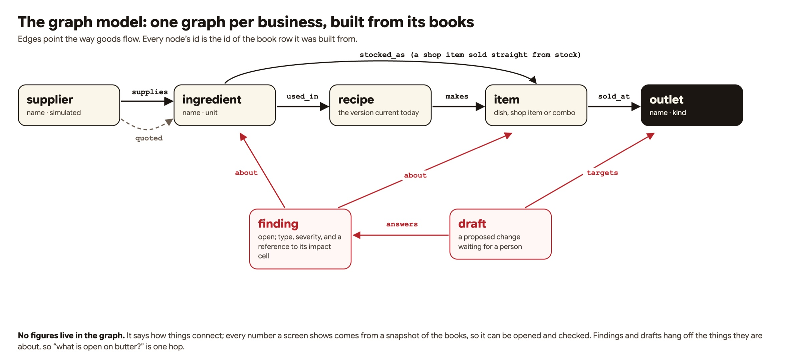
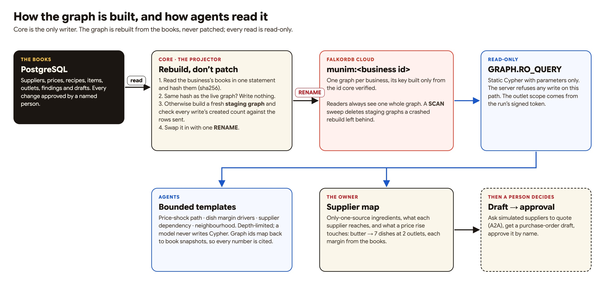
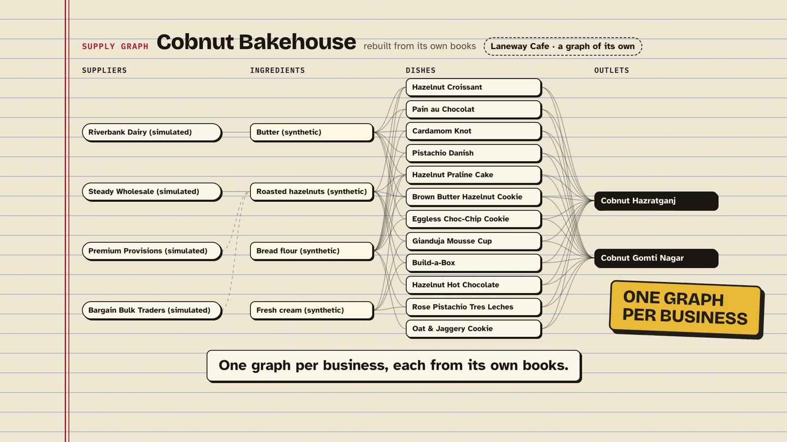
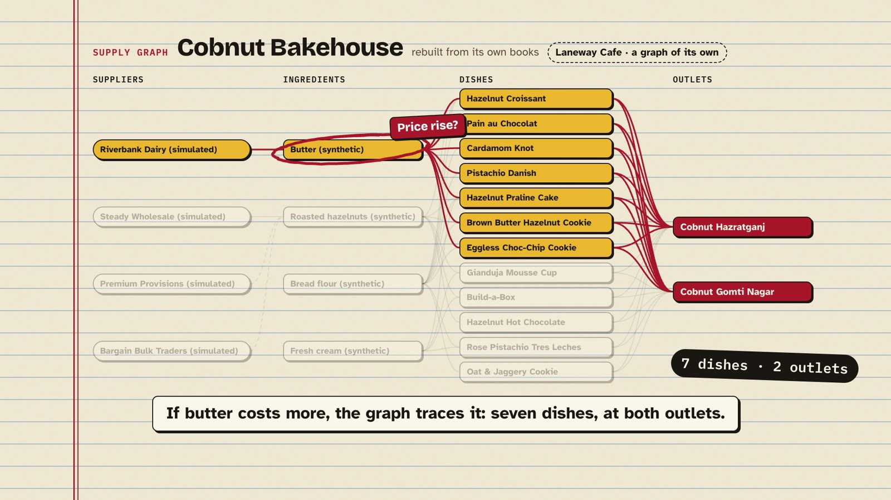
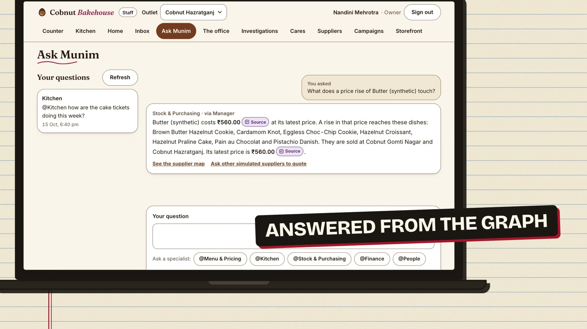
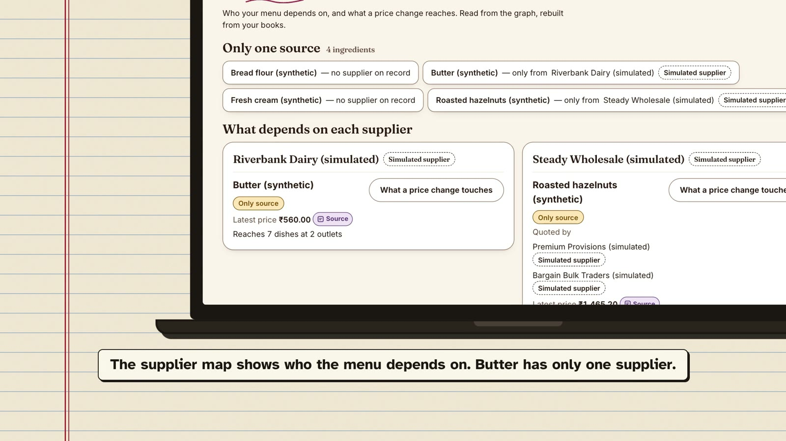
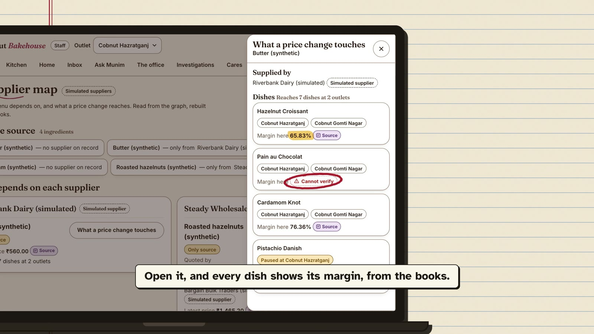

# Follow the butter: building an AI back office that answers in graphs

_How Munim uses FalkorDB to show a restaurant owner what a price rise really touches, and why the AI is never allowed to
change the books._

**Watch the demo:** https://youtu.be/B0ydJVcgB7E

---

Ask a restaurant owner what happens if butter goes up by fifteen percent and you will get a pause, then a guess. Butter is
in the croissants, obviously. Probably the cookies. Something in the cake case. Across two outlets? Somewhere in a
spreadsheet there is an answer, but nobody has time to find it before the next delivery arrives.

That pause is the problem we set out to solve.

## The problem: money leaks quietly

Restaurant groups with two to five outlets, cloud kitchens and neighbourhood shops run on thin margins and rarely have a
finance team. Money leaks in small, boring ways: waste that creeps up at one outlet, a supplier whose price drifts, an
ingredient that only one supplier can deliver, regulars who stop coming. The owner usually finds out at month end, from
software that records what was sold but never explains it.

The current wave of AI assistants does not fix this. A chatbot that invents a number is worse than no answer, and an
assistant that can change prices or place orders on its own is a risk nobody running a business should accept.

## What we built: Munim

Munim is an AI back office. One system runs the storefront, the till, the kitchen display, stock, purchasing, the ledgers
and the customer list. On top of it, a Manager and eight specialist agents (menu and pricing, kitchen, stock and
purchasing, finance, people, customers, compliance and market) watch the books, explain what happened, find money leaking
out and draft the fix.

Everything rests on one rule we call the One Guarantee:

> Nothing changes the books without a named person’s approval, and every number shown traces to a ledger row.

The AI has no write path to the books at all. When it cannot trace a number to a row, it says “Cannot verify”.

## Why a graph

Most of the questions an owner asks are not totals. They are paths.

- _If butter costs more, what does it touch?_ Supplier → ingredient → recipe → dish → outlet.
- _Which ingredients depend on one supplier?_ Ingredients with exactly one incoming supply edge.
- _What drives this dish’s margin?_ Dish → recipe → ingredients → their suppliers and latest prices.

You can answer these with joins, but each new question becomes a new tangle of SQL, and multi-hop questions get slow and
hard to read. In a graph they are short, readable Cypher. So we built **Munim Business Graph** on FalkorDB.

_The graph model. Edges point the way goods flow; findings and drafts hang off the things they are about. No figures live in
the graph: every number a screen shows comes from the books._

## How the graph is built

The books stay in Postgres; that is where approvals and the audit trail live. The graph is a projection of them, rebuilt
from scratch rather than patched:

1. **One graph per business.** Each business gets its own graph key, built only from the business id the core has
   verified. Nothing a user types, and nothing a model says, can name another business’s graph.
2. **Hash first.** The core reads the business’s books in one statement and hashes them. If the hash matches the live
   graph, nothing is written.
3. **Build beside, then swap.** Otherwise it writes a fresh staging graph, checks that every write created exactly the
   nodes and edges it sent, and swaps it in with a single `RENAME`. Readers always see one whole graph, never half of one.
4. **Clean up after failures.** A rebuild that dies halfway leaves a staging key behind; a `SCAN` sweep removes it.

For the demo bakery the whole graph builds in about two seconds.

## How the agents use it

This is the part we cared about most. An agent that can write its own database queries is an agent that can be talked
into anything. So:

- **Agents never write Cypher.** They pick from a short list of templates (price-shock path, dish margin drivers, supplier
  dependency, neighbourhood), each with a depth limit.
- **Every read is `GRAPH.RO_QUERY`.** The database itself refuses writes on that path, so a read can never change data.
- **Scope comes from a signed token, not a prompt.** The core signs a short-lived token for each agent run; the business
  and its outlets come from that token, never from the model.
- **The graph returns structure, not figures.** Ids, kinds and hops. Any number the owner sees is mapped back to a snapshot
  of the books, so the answer cites its sources.

Ask Munim “What does a price rise of butter touch?” and the answer comes back from the graph: seven dishes, at both outlets,
with butter’s latest price cited from the books.

## What it looks like

The **supplier map** is where this becomes visible. It shows which ingredients have only one source, what each supplier’s
goods reach, and, for any ingredient, what a price change touches, each dish with its margin and a source chip.

From there the owner can ask other suppliers for quotes; Munim’s agent negotiates with them agent to agent, inside limits
set from the last price paid, and code, not a model, checks every deal. The result is a purchase-order draft that a named
person approves.

(In the demo, the business is a synthetic two-outlet bakery, the suppliers are simulated agents, and payments are recorded,
never processed.)

## What we learned

1. **Rebuild, don’t patch.** Keeping a graph in sync with a transactional database through incremental updates is a bug
   farm. Projecting from the source of truth, with a hash to skip unchanged rebuilds, was simpler and fast enough.
2. **Let the database enforce the boundary.** `GRAPH.RO_QUERY` turned “the AI only reads” from a convention into a
   guarantee the server keeps.
3. **Never let a model write a query.** Bounded templates gave the agents all the reach they needed with none of the risk.
4. **Keep numbers out of the graph’s answers.** The graph says how things connect; the books say how much. Mapping graph
   ids back to book snapshots is what lets every figure carry its source.
5. **Design for the graph being down.** If FalkorDB is unreachable, Munim says the graph is unavailable instead of
   guessing, and every other part of the product keeps working.
6. **Test against the real thing.** Running a real embedded FalkorDB in our test suites, rather than a mock, caught the
   kind of mistakes that only a real server shows.

## What’s next

Pilots with restaurant groups on their own data, more of the graph in the owner’s morning brief, and delivery-platform
payouts as a new kind of edge, because a deduction nobody agreed to is just another path to follow.

---

**Try it:** [munim-rho.vercel.app](https://munim-rho.vercel.app) (press “Try the live demo”) ·
**Code:** [github.com/SawhneySatvik/business-graph](https://github.com/SawhneySatvik/business-graph) ·
**Video:** [youtu.be/B0ydJVcgB7E](https://youtu.be/B0ydJVcgB7E) ·
**Graph model:** [docs/graph-model.md](../graph-model.md) · **Cypher:** [docs/cypher.md](../cypher.md)

_Built for FalkorDB Graph Hacks 2026, track: Agents That Act on Connected Data._
