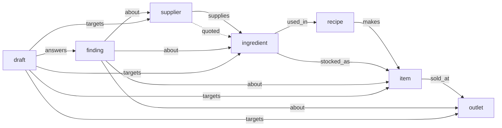

# The graph model

Munim keeps its books in Postgres. FalkorDB holds the **connected model of the business** built from those books: who
supplies what, what each dish is made of, where it is sold, and which open findings and pending drafts sit on those
things. Every "what does this touch" question runs on that model. The graph never stores a number that a screen shows;
numbers come from the books, through snapshots that can be opened.



Edges point the way goods flow: supplier, ingredient, recipe, menu item, outlet. Labels and properties are lowercase, and
each node has exactly one label. The queries that read and write it are in [`cypher.md`](./cypher.md).

## Nodes

Every node's `id` is the id of the book row it was built from, so a graph answer and a snapshot row about the same dish
share one id and join with no lookup.

| Label | Properties | One node per | Built from |
|---|---|---|---|
| `outlet` | `id`, `name`, `kind` | outlet | `core.outlet` |
| `supplier` | `id`, `name`, `simulated` | active supplier | `core.supplier` (`simulated` is `kind = 'simulated'`; every demo supplier is simulated) |
| `ingredient` | `id`, `name`, `unit` | active stock item | `core.ingredient` (`unit` is its base unit) |
| `recipe` | `id`, `name` (`<dish> recipe`), `item_id`, `variant_id` | recipe version current on the build date, of an active item | `core.recipe_version` |
| `item` | `id`, `name`, `kind` (`dish`, `sku` for a shop item, or `combo`), `category` | active menu item | `core.item` (its display name, else its name key) |
| `finding` | `id`, `name` (its type), `type`, `severity`, `outlet_ids`, `impact_snapshot_id`, `impact_row`, `impact_column` | open finding | `intel.finding` (`status = 'open'`); the finding's text is never copied |
| `draft` | `id`, `name` (its command type), `command_type`, `outlet_ids` | proposed draft | `core.draft` (`status = 'proposed'`) |
| `projection` | `source_sha256`, `as_of`, `projected_at`, `model` | graph (one) | written by the projector; no read returns it but `projection_state` |

`impact_row` is the row index of a snapshot cell: part of a reference, never a figure to show. Recipe and draft names carry
no id and no digit.

## Edges

| Type | From → to | Property | Built from |
|---|---|---|---|
| `supplies` | supplier → ingredient | `ref`: the newest `core.supplier_price` or `core.po_line` row for the pair | price lists, and lines of purchase orders that are not cancelled |
| `quoted` | supplier → ingredient | `ref`: the newest `intel.supplier_quote` | quotes from simulated suppliers in the last 90 days (a quote is not a source of supply) |
| `used_in` | ingredient → recipe | `ref`: the `core.recipe_line` | lines of current recipe versions |
| `makes` | recipe → item | `ref`: the `core.recipe_version` | the recipe version's item |
| `stocked_as` | ingredient → item | `ref`: the `core.item` | a shop item sold straight from stock |
| `sold_at` | item → outlet | `ref`: the current `core.price`; `available` | an item with a current price at the outlet (the counter price when there are several); `available` is that outlet's latest availability, true when none is recorded |
| `about` | finding → ingredient, item, supplier or outlet | `ref` | the id columns (`item_id`, `ingredient_id`, `supplier_id`, `outlet_id`) of the finding's impact row, in a snapshot core minted, and the `row:core.<table>:<id>` references core resolved in the finding |
| `answers` | draft → finding | `ref`: the `core.draft` | the finding a draft answers |
| `targets` | draft → ingredient, item, supplier or outlet | `ref`: the `core.draft` | every `item_id`, `ingredient_id`, `supplier_id`, `outlet_id` and `outlet_ids[]` in the draft's payload, which core validated when it stored the draft |

`ref` always names the book row an edge came from (`core.supplier_price:<id>`, `core.recipe_line:<id>`, …), so any edge can
be traced back to the books.

## What is not in the graph

- People: staff, customers, members. FalkorDB has no row-level security, so personal data stays in Postgres.
- Orders and sales.
- Quantities, prices and money of any kind.
- Claims, documents and messages (text that came from outside).
- Anything a model wrote.

Sales volumes, margins and prices come from snapshots, which the screen mints itself and shows with their source chips.

## Tenants and outlet scope

- **One graph per business.** The key is `munim:<tenant id>`, built by core from the tenant it verified (a member's
  sign-in or an agent's run token) and checked to be exactly one uuid
  ([`adapters/falkordb/src/swap.ts`](../adapters/falkordb/src/swap.ts)). No query text, parameter or tool argument names a
  tenant, so a query cannot reach another business: there is no predicate to forget. `adapters/falkordb/test/guard.test.ts`
  and `queries.test.ts` build two tenants with the same ids and check that neither ever sees the other's names.
- **Outlet scope.** Suppliers, ingredients, recipes and items belong to the whole business. Someone who sees only some
  outlets sees only those outlet nodes, and only the findings and drafts whose `outlet_ids` overlap their outlets (an empty
  list overlaps nothing, the same rule as the row-level security on `intel.finding` and `core.draft`). Walks never pass
  through a node the caller cannot see. The scope reaches each read as `$outlets`, from the membership or the run token.

## How the graph is built

Core is the only writer. The AI service (intel) has no FalkorDB client and reads no graph setting; it reaches the graph only through core's read-only `graph:query`. No route it can call writes the graph.

1. **One statement reads the books.** [`adapters/falkordb/projection.sql`](../adapters/falkordb/projection.sql) returns the
   whole graph of one business as one JSON document, plus its checksum, computed in SQL over the same bytes:
   `encode(sha256(convert_to(doc::text, 'UTF8')), 'hex')`. Every list in it is ordered by id, so the same books always give
   the same bytes. It runs as core's service role, which has no write grant on any book table, in a transaction that sets
   the business with `SET LOCAL`, and every leg also filters on `tenant_id = :tenant_id`. Isolation therefore holds twice,
   and `adapters/falkordb/test/projection.test.ts` proves each layer alone: the predicates with row-level security out of
   the way, and row-level security with every predicate stripped. `:as_of` is today in the business's home time zone.
2. **Compare.** The live graph's `projection` node holds the checksum it was built from (`projection_state`). The same
   checksum means nothing is written: a re-run with unchanged books is a no-op.
3. **Build a staging graph.** Under a fresh key, `munim:<tenant>:next:<epoch ms>:<uuid>`, so two builders never share one:
   the seven indexes, then one write per label and per edge type with `$rows`, then the `projection` node. After each write
   the count FalkorDB reports created must equal the rows sent; a shortfall deletes the staging graph and leaves the live
   one untouched.
4. **Swap.** `RENAME` replaces the live graph with the staging graph in one step and frees the old one.

When it runs ([`adapters/falkordb/src/index.ts`](../adapters/falkordb/src/index.ts),
[`services/core-worker/src/graph/index.ts`](../services/core-worker/src/graph/index.ts)):

- **Before every graph read**: each `/v1/graph/*` route and each `graph:query` brings the graph up to date first, so an
  answer always matches the books at the moment it is read.
- **On the worker's `graph-project` job**, every 15 minutes in a long-running core-worker, for every active business, and
  it deletes staging keys older than an hour that a build which died half-way left behind (`SCAN munim:*:next:*`). On the
  Vercel deployment the worker's jobs run from one daily cron call; reads still rebuild first.

`adapters/falkordb/test/projection.test.ts` checks the node and edge counts of a seeded Cobnut business against counts
typed from the world's definition and counts taken from the books, that a re-run writes nothing, that a recipe change
rebuilds, and that names with quotes, braces, newlines and Cypher-looking text come back byte for byte.

## When FalkorDB is down

There is no other graph in this build. When FalkorDB does not answer, every graph route answers
`503 graph_unavailable`, the supplier map says so ("Your books are fine; try again in a minute."), and the agent's graph
tools tell the model the graph is offline, so it answers from its other tools without it. Nothing falls back to Postgres:
`adapters/falkordb/test/core-api.test.ts` stops the server and checks every route and `graph:query`, with `intel.edge`
taken away from core's service role so that any read of it would fail.

## The projection document

The statement's output, abbreviated (each list holds one map per node or edge, ordered by id):

```json
{
  "as_of": "2026-10-17",
  "outlet":     [{"id": "…", "name": "Cobnut Hazratganj", "kind": "…"}],
  "supplier":   [{"id": "…", "name": "Riverbank Dairy (simulated)", "simulated": true}],
  "ingredient": [{"id": "…", "name": "Butter (synthetic)", "unit": "…"}],
  "item":       [{"id": "…", "name": "Hazelnut Croissant", "kind": "dish", "category": "…"}],
  "recipe":     [{"id": "…", "name": "Hazelnut Croissant recipe", "item_id": "…", "variant_id": null}],
  "finding":    [{"id": "…", "type": "…", "severity": "…", "outlet_ids": ["…"], "impact_snapshot_id": "…", "impact_row": 0, "impact_column": "…"}],
  "draft":      [{"id": "…", "command_type": "…", "outlet_ids": ["…"]}],
  "supplies":   [{"src": "<supplier>", "dst": "<ingredient>", "ref": "core.supplier_price:…"}],
  "quoted":     [{"src": "<supplier>", "dst": "<ingredient>", "ref": "intel.supplier_quote:…"}],
  "used_in":    [{"src": "<ingredient>", "dst": "<recipe>", "ref": "core.recipe_line:…"}],
  "makes":      [{"src": "<recipe>", "dst": "<item>", "ref": "core.recipe_version:…"}],
  "stocked_as": [{"src": "<ingredient>", "dst": "<item>", "ref": "core.item:…"}],
  "sold_at":    [{"src": "<item>", "dst": "<outlet>", "ref": "core.price:…", "available": true}],
  "about":      [{"src": "<finding>", "dst": "<node>", "ref": "evidence.snapshot:…"}],
  "answers":    [{"src": "<draft>", "dst": "<finding>", "ref": "core.draft:…"}],
  "targets":    [{"src": "<draft>", "dst": "<node>", "ref": "core.draft:…"}]
}
```

The statement's parts, in order: the current recipe versions, the current price per item and outlet, the latest
availability per item and outlet, the set of node ids (so that no edge can point outside the business's active nodes), the
newest source per supplier and ingredient, the newest quote per pair in the last 90 days, the open findings and proposed
drafts, the `about` and `targets` edges (from core-held values only: a snapshot's id columns and references core resolved,
never the text), and finally the document and its checksum.
